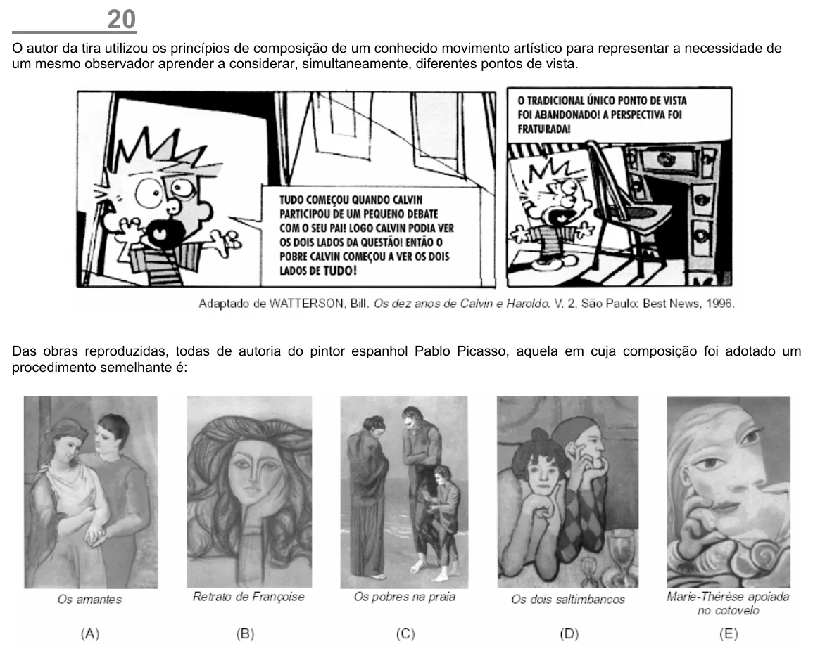

Texto extraído (pode conter ruído)

20  
O autor da tira utilizou os princípios de composição de um conhecido movimento artístico para representar a necessidade de  
um mesmo observador aprender a considerar, simultaneamente, diferentes pontos de vista.  
Das obras reproduzidas, todas de autoria do pintor espanhol Pablo Picasso, aquela em cuja composição foi adotado um  
procedimento semelhante é:

