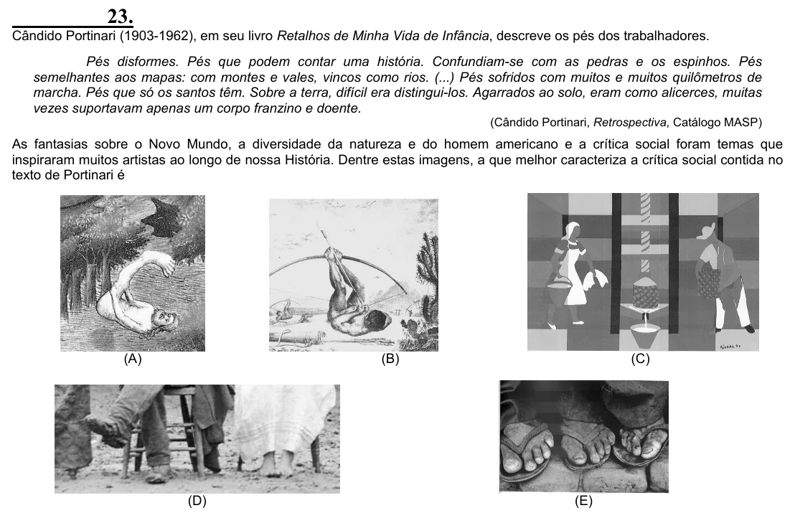

Texto extraído (pode conter ruído)

23.  
Cândido Portinari (1903-1962), em seu livro Retalhos de Minha Vida de Infância, descreve os pés dos trabalhadores.  
Pés disformes. Pés que podem contar uma história. Confundiam-se com as pedras e os espinhos. Pés  
semelhantes aos mapas: com montes e vales, vincos como rios. (...) Pés sofridos com muitos e muitos quilômetros de  
marcha. Pés que só os santos têm. Sobre a terra, difícil era distingui-los. Agarrados ao solo, eram como alicerces, muitas  
vezes suportavam apenas um corpo franzino e doente.  
(Cândido Portinari, Retrospectiva, Catálogo MASP)  
As fantasias sobre o Novo Mundo, a diversidade da natureza e do homem americano e a crítica social foram temas que  
inspiraram muitos artistas ao longo de nossa História. Dentre estas imagens, a que melhor caracteriza a crítica social contida no  
texto de Portinari é  
(A)  
(B)  
(C)  
(D)  
(E)

