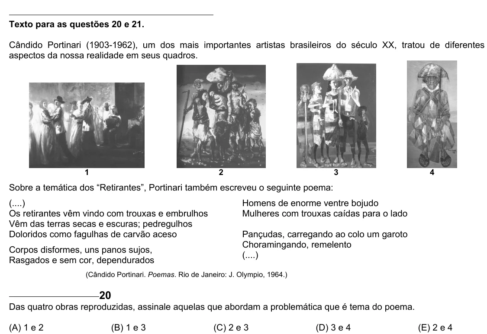

Texto extraído (pode conter ruído)

Texto para as questões 20 e 21.  
Cândido Portinari (1903-1962), um dos mais importantes artistas brasileiros do século XX, tratou de diferentes  
aspectos da nossa realidade em seus quadros.  
1  
2  
3  
4  
Sobre a temática dos “Retirantes”, Portinari também escreveu o seguinte poema:  
(....)  
Homens de enorme ventre bojudo  
Os retirantes vêm vindo com trouxas e embrulhos  
Mulheres com trouxas caídas para o lado  
Vêm das terras secas e escuras; pedregulhos  
Doloridos como fagulhas de carvão aceso  
Pançudas, carregando ao colo um garoto  
Choramingando, remelento  
Corpos disformes, uns panos sujos,  
(....)  
Rasgados e sem cor, dependurados  
(Cândido Portinari. Poemas. Rio de Janeiro: J. Olympio, 1964.)  
20  
Das quatro obras reproduzidas, assinale aquelas que abordam a problemática que é tema do poema.  
(A) 1 e 2  
(B) 1 e 3  
(C) 2 e 3  
(D) 3 e 4  
(E) 2 e 4

