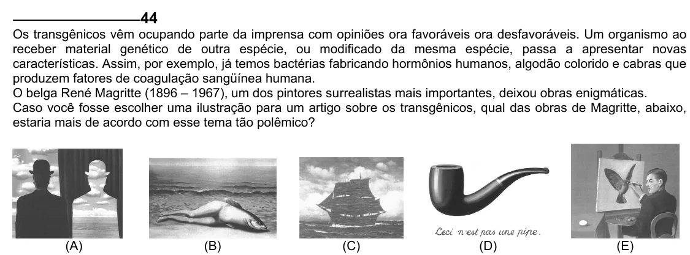

Texto extraído (pode conter ruído)

44  
Os transgênicos vêm ocupando parte da imprensa com opiniões ora favoráveis ora desfavoráveis. Um organismo ao  
receber material genético de outra espécie, ou modificado da mesma espécie, passa a apresentar novas  
características. Assim, por exemplo, já temos bactérias fabricando hormônios humanos, algodão colorido e cabras que  
produzem fatores de coagulação sangüínea humana.  
O belga René Magritte (1896 – 1967), um dos pintores surrealistas mais importantes, deixou obras enigmáticas.  
Caso você fosse escolher uma ilustração para um artigo sobre os transgênicos, qual das obras de Magritte, abaixo,  
estaria mais de acordo com esse tema tão polêmico?  
(A)  
(B)  
(C)  
(D)  
(E)

