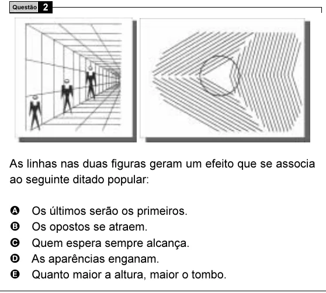

Texto extraído (pode conter ruído)

2  
Questão  
As linhas nas duas figuras geram um efeito que se associa  
ao seguinte ditado popular:  
A  
Os últimos serão os primeiros.  
B  
Os opostos se atraem.  
C  
Quem espera sempre alcança.  
D  
As aparências enganam.  
E  
Quanto maior a altura, maior o tombo.

