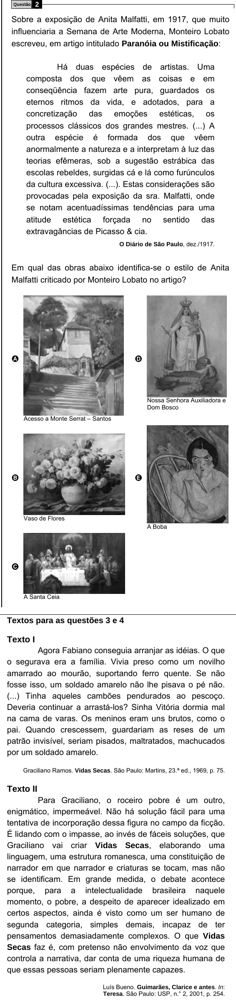

Texto extraído (pode conter ruído)

Questão  
2  
Sobre a exposição de Anita Malfatti, em 1917, que muito  
influenciaria a Semana de Arte Moderna, Monteiro Lobato  
escreveu, em artigo intitulado Paranóia ou Mistificação:  
Há duas espécies de artistas. Uma  
composta dos que vêem as coisas e em  
conseqüência fazem arte pura, guardados os  
eternos ritmos da vida, e adotados, para a  
concretização das emoções estéticas, os  
processos clássicos dos grandes mestres. (...) A  
outra espécie é formada dos que vêem  
anormalmente a natureza e a interpretam à luz das  
teorias efêmeras, sob a sugestão estrábica das  
escolas rebeldes, surgidas cá e lá como furúnculos  
da cultura excessiva. (...). Estas considerações são  
provocadas pela exposição da sra. Malfatti, onde  
se notam acentuadíssimas tendências para uma  
atitude estética forçada no sentido das  
extravagâncias de Picasso & cia.  
O Diário de São Paulo, dez./1917.  
Em qual das obras abaixo identifica-se o estilo de Anita  
Malfatti criticado por Monteiro Lobato no artigo?  
A  
D  
Nossa Senhora Auxiliadora e  
Dom Bosco  
Acesso a Monte Serrat – Santos  
B  
E  
Vaso de Flores  
A Boba  
C  
A Santa Ceia  
Textos para as questões 3 e 4  
Texto I  
Agora Fabiano conseguia arranjar as idéias. O que  
o segurava era a família. Vivia preso como um novilho  
amarrado ao mourão, suportando ferro quente. Se não  
fosse isso, um soldado amarelo não lhe pisava o pé não.  
(...) Tinha aqueles cambões pendurados ao pescoço.  
Deveria continuar a arrastá-los? Sinha Vitória dormia mal  
na cama de varas. Os meninos eram uns brutos, como o  
pai. Quando crescessem, guardariam as reses de um  
patrão invisível, seriam pisados, maltratados, machucados  
por um soldado amarelo.  
Graciliano Ramos. Vidas Secas. São Paulo: Martins, 23.ª ed., 1969, p. 75.  
Texto II  
Para Graciliano, o roceiro pobre é um outro,  
enigmático, impermeável. Não há solução fácil para uma  
tentativa de incorporação dessa figura no campo da ficção.  
É lidando com o impasse, ao invés de fáceis soluções, que  
Graciliano vai criar Vidas Secas, elaborando uma  
linguagem, uma estrutura romanesca, uma constituição de  
narrador em que narrador e criaturas se tocam, mas não  
se identificam. Em grande medida, o debate acontece  
porque, para a intelectualidade brasileira naquele  
momento, o pobre, a despeito de aparecer idealizado em  
certos aspectos, ainda é visto como um ser humano de  
segunda categoria, simples demais, incapaz de ter  
pensamentos demasiadamente complexos. O que Vidas  
Secas faz é, com pretenso não envolvimento da voz que  
controla a narrativa, dar conta de uma riqueza humana de  
que essas pessoas seriam plenamente capazes.  
Luís Bueno. Guimarães, Clarice e antes. In:  
Teresa. São Paulo: USP, n.° 2, 2001, p. 254.

