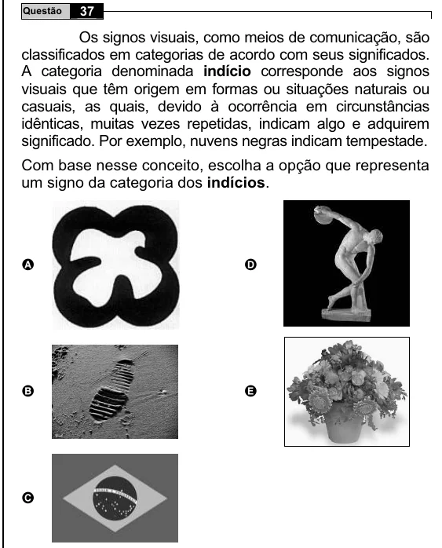

Texto extraído (pode conter ruído)

37  
Questão  
Os signos visuais, como meios de comunicação, são  
classificados em categorias de acordo com seus significados.  
A categoria denominada indício corresponde aos signos  
visuais que têm origem em formas ou situações naturais ou  
casuais, as quais, devido à ocorrência em circunstâncias  
idênticas, muitas vezes repetidas, indicam algo e adquirem  
significado. Por exemplo, nuvens negras indicam tempestade.  
Com base nesse conceito, escolha a opção que representa  
um signo da categoria dos indícios.  
A  
D  
B  
E  
C

