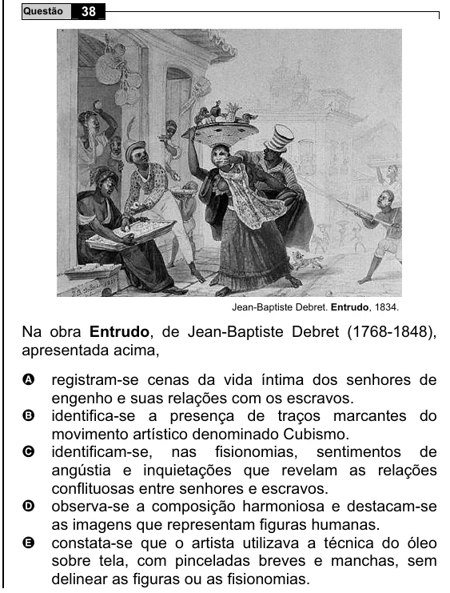

Texto extraído (pode conter ruído)

Questão  
38  
Jean-Baptiste Debret. Entrudo, 1834.  
Na obra Entrudo, de Jean-Baptiste Debret (1768-1848),  
apresentada acima,  
registram-se cenas da vida íntima dos senhores de  
A  
engenho e suas relações com os escravos.  
B  
identifica-se a presença de traços marcantes do  
movimento artístico denominado Cubismo.  
C  
identificam-se, nas fisionomias, sentimentos de  
angústia e inquietações que revelam as relações  
conflituosas entre senhores e escravos.  
D  
observa-se a composição harmoniosa e destacam-se  
as imagens que representam figuras humanas.  
constata-se que o artista utilizava a técnica do óleo  
E  
sobre tela, com pinceladas breves e manchas, sem  
delinear as figuras ou as fisionomias.

