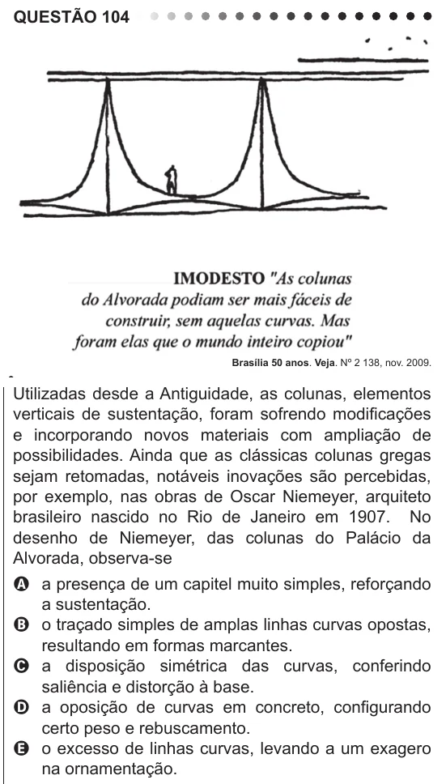

Texto extraído (pode conter ruído)

QUESTÃO 104  
Brasília 50 anos. Veja. Nº 2 138, nov. 2009.  
Utilizadas desde a Antiguidade, as colunas, elementos  
verticais de sustentação, foram sofrendo modificações  
e incorporando novos materiais com ampliação de  
possibilidades. Ainda que as clássicas colunas gregas  
sejam retomadas, notáveis inovações são percebidas,  
por exemplo, nas obras de Oscar Niemeyer, arquiteto  
brasileiro nascido no Rio de Janeiro em 1907. No  
desenho de Niemeyer, das colunas do Palácio da  
Alvorada, observa-se  
A a presença de um capitel muito simples, reforçando  
a sustentação.  
B o traçado simples de amplas linhas curvas opostas,  
resultando em formas marcantes.  
C a disposição simétrica das curvas, conferindo  
saliência e distorção à base.  
D a oposição de curvas em concreto, configurando  
certo peso e rebuscamento.  
E o excesso de linhas curvas, levando a um exagero  
na ornamentação.

