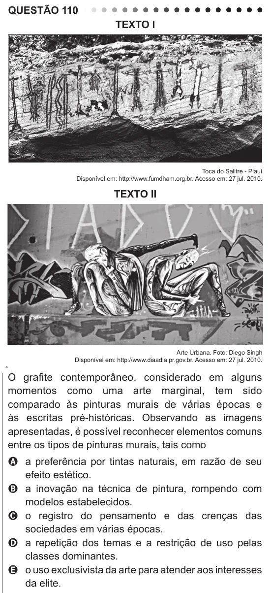

Texto extraído (pode conter ruído)

QUESTÃO 110  
TEXTO I  
Toca do Salitre - Piauí  
Disponível em: http://www.fumdham.org.br. Acesso em: 27 jul. 2010.  
TEXTO II  
Arte Urbana. Foto: Diego Singh  
Disponível em: http://www.diaadia.pr.gov.br. Acesso em: 27 jul. 2010.  
O grafite contemporâneo, considerado em alguns  
momentos como uma arte marginal, tem sido  
comparado às pinturas murais de várias épocas e  
às escritas pré-históricas. Observando as imagens  
apresentadas, é possível reconhecer elementos comuns  
entre os tipos de pinturas murais, tais como  
A a preferência por tintas naturais, em razão de seu  
efeito estético.  
B a inovação na técnica de pintura, rompendo com  
modelos estabelecidos.  
C o registro do pensamento e das crenças das  
sociedades em várias épocas.  
D a repetição dos temas e a restrição de uso pelas  
classes dominantes.  
E o uso exclusivista da arte para atender aos interesses  
da elite.

