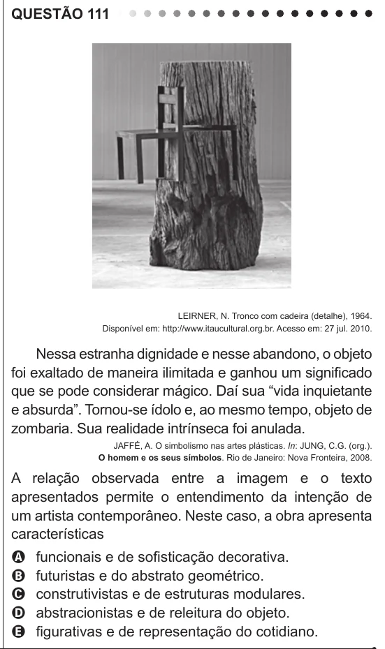

Texto extraído (pode conter ruído)

QUESTÃO 111  
LEIRNER, N. Tronco com cadeira (detalhe), 1964.  
Disponível em: http://www.itaucultural.org.br. Acesso em: 27 jul. 2010.  
Nessa estranha dignidade e nesse abandono, o objeto  
foi exaltado de maneira ilimitada e ganhou um significado  
que se pode considerar mágico. Daí sua “vida inquietante  
e absurda”. Tornou-se ídolo e, ao mesmo tempo, objeto de  
zombaria. Sua realidade intrínseca foi anulada.  
JAFFÉ, A. O simbolismo nas artes plásticas. In: JUNG, C.G. (org.).  
O homem e os seus símbolos. Rio de Janeiro: Nova Fronteira, 2008.  
A relação observada entre a imagem e o texto  
apresentados permite o entendimento da intenção de  
um artista contemporâneo. Neste caso, a obra apresenta  
características  
funcionais e de sofisticação decorativa.  
A  
B  
futuristas e do abstrato geométrico.  
construtivistas e de estruturas modulares.  
C  
abstracionistas e de releitura do objeto.  
D  
figurativas e de representação do cotidiano.  
E

