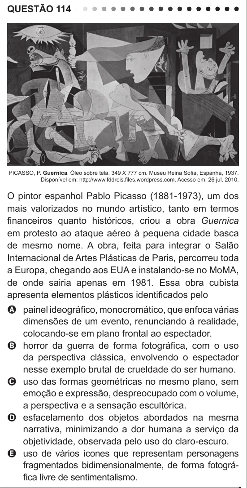

Texto extraído (pode conter ruído)

QUESTÃO 114  
PICASSO, P. Guernica. Óleo sobre tela. 349 X 777 cm. Museu Reina Sofia, Espanha, 1937.  
Disponível em: http://www.fddreis.files.wordpress.com. Acesso em: 26 jul. 2010.  
O pintor espanhol Pablo Picasso (1881-1973), um dos  
mais valorizados no mundo artístico, tanto em termos  
financeiros quanto históricos, criou a obra Guernica  
em protesto ao ataque aéreo à pequena cidade basca  
de mesmo nome. A obra, feita para integrar o Salão  
Internacional de Artes Plásticas de Paris, percorreu toda  
a Europa, chegando aos EUA e instalando-se no MoMA,  
de onde sairia apenas em 1981. Essa obra cubista  
apresenta elementos plásticos identificados pelo  
A painel ideográfico, monocromático, que enfoca várias  
dimensões de um evento, renunciando à realidade,  
colocando-se em plano frontal ao espectador.  
B horror da guerra de forma fotográfica, com o uso  
da perspectiva clássica, envolvendo o espectador  
nesse exemplo brutal de crueldade do ser humano.  
C uso das formas geométricas no mesmo plano, sem  
emoção e expressão, despreocupado com o volume,  
a perspectiva e a sensação escultórica.  
D esfacelamento dos objetos abordados na mesma  
narrativa, minimizando a dor humana a serviço da  
objetividade, observada pelo uso do claro-escuro.  
E uso de vários ícones que representam personagens  
fragmentados bidimensionalmente, de forma fotográ-  
fica livre de sentimentalismo.

