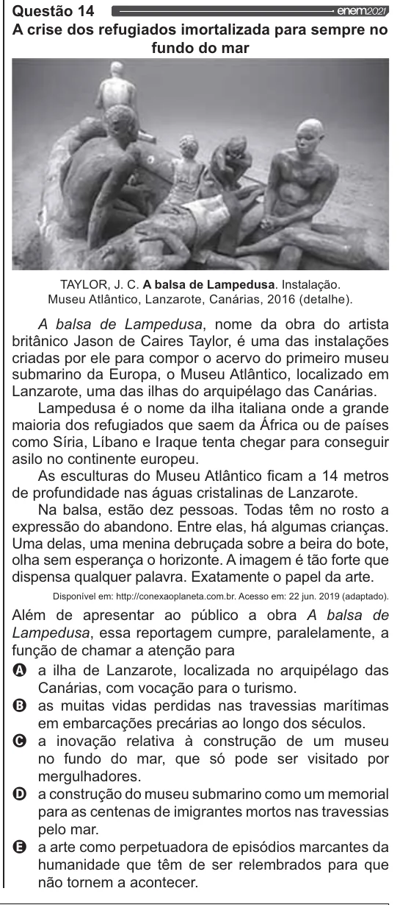

Texto extraído (pode conter ruído)

Questão 14 enem202  
A crise dos refugiados imortalizada para sempre no  
fundo do mar  
TAYLOR, J. C. A balsa de Lampedusa. Instalação.  
Museu Atlântico, Lanzarote, Canárias, 2016 (detalhe).  
A balsa de Lampedusa, nome da obra do artista  
britânico Jason de Caires Taylor, é uma das instalações  
criadas por ele para compor o acervo do primeiro museu  
submarino da Europa, o Museu Atlântico, localizado em  
Lanzarote, uma das ilhas do arquipélago das Canárias.  
Lampedusa é o nome da ilha italiana onde a grande  
maioria dos refugiados que saem da África ou de países  
como Síria, Líbano e Iraque tenta chegar para conseguir  
asilo no continente europeu.  
As esculturas do Museu Atlântico ficam a 14 metros  
de profundidade nas águas cristalinas de Lanzarote.  
Na balsa, estão dez pessoas. Todas têm no rosto a  
expressão do abandono. Entre elas, há algumas crianças.  
Uma delas, uma menina debruçada sobre a beira do bote,  
olha sem esperança o horizonte. A imagem é tão forte que  
dispensa qualquer palavra. Exatamente o papel da arte.  
Disponível em: http://conexaoplaneta.com.br. Acesso em: 22 jun. 2019 (adaptado).  
Além de apresentar ao público a obra A balsa de  
Lampedusa, essa reportagem cumpre, paralelamente, a  
função de chamar a atenção para  
Q a ilha de Lanzarote, localizada no arquipélago das  
Canárias, com vocação para o turismo.  
O as muitas vidas perdidas nas travessias marítimas  
em embarcações precárias ao longo dos séculos.  
O a inovação relativa à construção de um museu  
no fundo do mar, que só pode ser visitado por  
mergulhadores.  
O a construção do museu submarino como um memorial  
para as centenas de imigrantes mortos nas travessias  
pelo mar.  
& a arte como perpetuadora de episódios marcantes da  
humanidade que têm de ser relembrados para que  
não tornem a acontecer.

