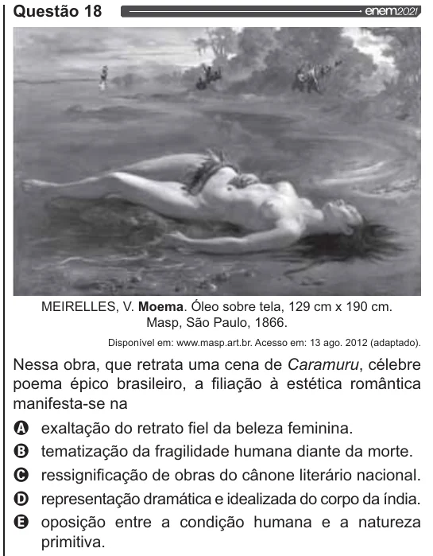

Texto extraído (pode conter ruído)

Questão 18  
MEIRELLES, V. Moema. Óleo sobre tela, 129 cm x 190 cm.  
Masp, São Paulo, 1866.  
Disponível em: www.masp.art.br. Acesso em: 13 ago. 2012 (adaptado).  
Nessa obra, que retrata uma cena de Caramuru, célebre  
poema épico brasileiro, a filiação à estética romântica  
manifesta-se na  
Q exaltação do retrato fiel da beleza feminina.  
O tematização da fragilidade humana diante da morte.  
O ressignificação de obras do cânone literário nacional.  
O representação dramática e idealizada do corpo da índia.  
& oposição entre a condição humana e a natureza  
primitiva.

