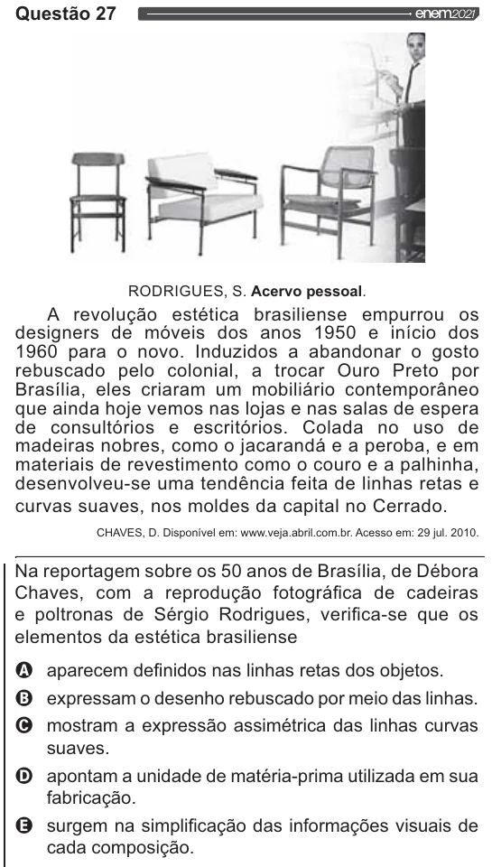

Texto extraído (pode conter ruído)

Questão 27  
RODRIGUES, S. Acervo pessoal.  
A revolução estética brasiliense empurrou os  
designers de móveis dos anos 1950 e início dos  
1960 para o novo. Induzidos a abandonar o gosto  
rebuscado pelo colonial, a trocar Ouro Preto por  
Brasília, eles criaram um mobiliário contemporâneo  
que ainda hoje vemos nas lojas e nas salas de espera  
de consultórios e escritórios. Colada no uso de  
madeiras nobres, como o jacarandá e a peroba, e em  
materiais de revestimento como o couro e a palhinha,  
desenvolveu-se uma tendência feita de linhas retas e  
curvas suaves, nos moldes da capital no Cerrado.  
CHAVES, D. Disponível em: www.veja.abril.com.br. Acesso em: 29 jul. 2010.  
Na reportagem sobre os 50 anos de Brasília, de Débora  
Chaves, com a reprodução fotográfica de cadeiras  
e poltronas de Sérgio Rodrigues, verifica-se que os  
elementos da estética brasiliense  
aparecem definidos nas linhas retas dos objetos.  
expressam o desenho rebuscado por meio das linhas.  
O mostram a expressão assimétrica das linhas curvas  
suaves.  
apontam a unidade de matéria-prima utilizada em sua  
fabricação.  
surgem na simplificação das informações visuais de  
cada composição.

