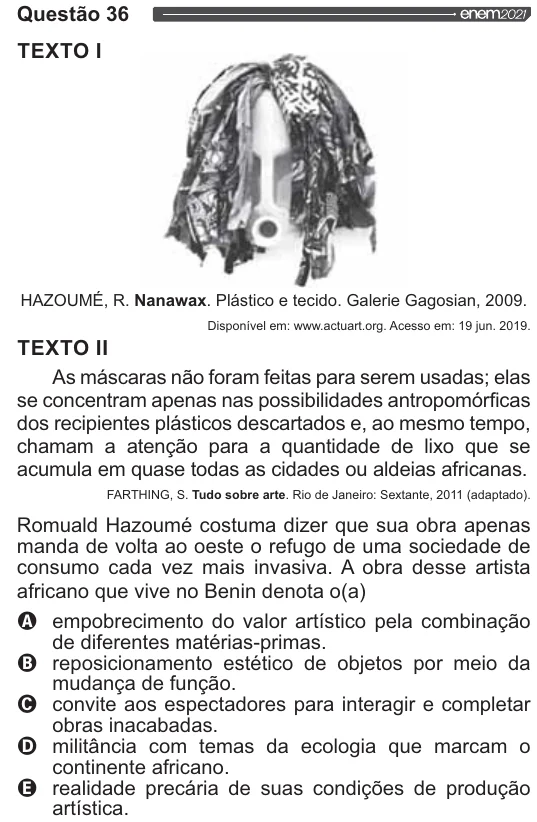

Texto extraído (pode conter ruído)

Questão 36  
TEXTO I  
HAZOUMÉ, R. Nanawax. Plástico e tecido. Galerie Gagosian, 2009.  
Disponível em: www.actuart.org. Acesso em: 19 jun. 2019.  
TEXTO II  
As máscaras não foram feitas para serem usadas; elas  
se concentram apenas nas possibilidades antropomórficas  
dos recipientes plásticos descartados e, ao mesmo tempo,  
chamam a atenção para a quantidade de lixo que se  
acumula em quase todas as cidades ou aldeias africanas.  
FARTHING, S. Tudo sobre arte. Rio de Janeiro: Sextante, 2011 (adaptado).  
Romuald Hazoumé costuma dizer que sua obra apenas  
manda de volta ao oeste o refugo de uma sociedade de  
consumo cada vez mais invasiva. A obra desse artista  
africano que vive no Benin denota o(a)  
oo vo  
empobrecimento do valor artístico pela combinação  
de diferentes matérias-primas.  
reposicionamento estético de objetos por meio da  
mudança de função.  
convite aos espectadores para interagir e completar  
obras inacabadas.  
militância com temas da ecologia que marcam o  
continente africano.  
realidade precária de suas condições de produção  
artística.

