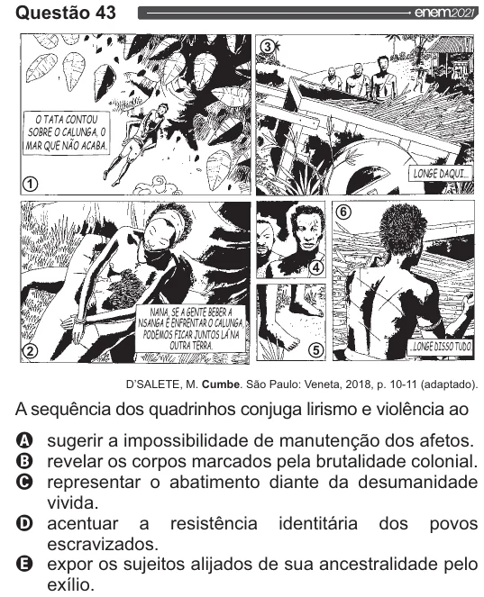

Texto extraído (pode conter ruído)

Questão 43  
ONZE  
[ oTaTA contou |"  
| SOBRE O CALUNGA, O  
| MAR QUE NÃO ACABA  
NANA, SE A GENTE BERER  
NSANSA E ENFRENTAR O CALUNGA,  
PODEMOS FICAR JUNTOS LANA  
OUTRA TERRA,  
D'SALETE, M. Cumbe. São Paulo: Veneta, 2018, p. 10-11 (adaptado).  
A sequência dos quadrinhos conjuga lirismo e violência ao  
009 O O  
sugerir a impossibilidade de manutenção dos afetos.  
revelar os corpos marcados pela brutalidade colonial.  
representar o abatimento diante da desumanidade  
vivida.  
acentuar a  
resistência identitária dos povos  
escravizados.  
expor os sujeitos alijados de sua ancestralidade pelo  
exílio.

