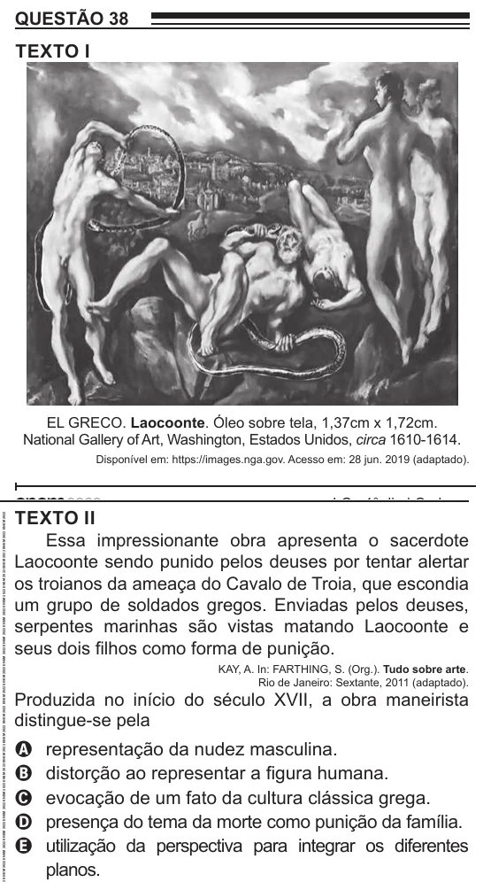

Texto extraído (pode conter ruído)

QUESTÃO 38  
TEXTO I  
EL GRECO. Laocoonte. Óleo sobre tela, 1,37cm x 1,72cm.  
National Gallery of Art, Washington, Estados Unidos, circa 1610-1614.  
Disponível em: https://images.nga.gov. Acesso em: 28 jun. 2019 (adaptado).  
TEXTO II  
Essa impressionante obra apresenta o sacerdote  
Laocoonte sendo punido pelos deuses por tentar alertar  
os troianos da ameaça do Cavalo de Troia, que escondia  
um grupo de soldados gregos. Enviadas pelos deuses,  
serpentes marinhas são vistas matando Laocoonte e  
seus dois filhos como forma de punição.  
KAY, A. In: FARTHING, S. (Org.). Tudo sobre arte.  
Rio de Janeiro: Sextante, 2011 (adaptado).  
Produzida no início do século XVII, a obra maneirista  
distingue-se pela  
representação da nudez masculina.  
A  
distorção ao representar a figura humana.  
B  
evocação de um fato da cultura clássica grega.  
C  
presença do tema da morte como punição da família.  
D  
utilização da perspectiva para integrar os diferentes  
E  
planos.

