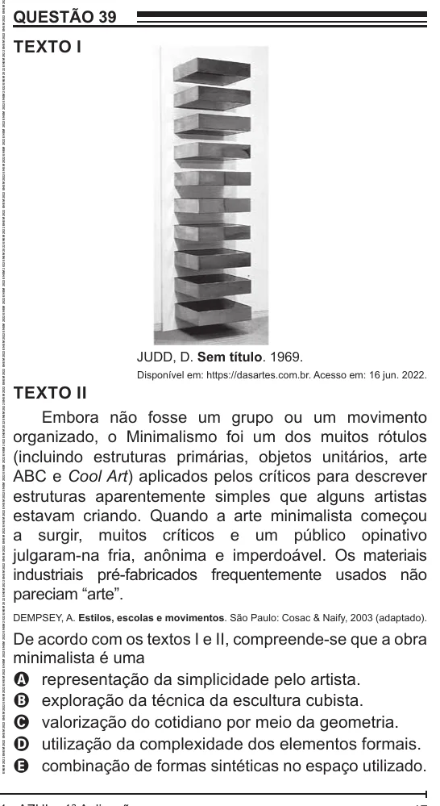

Texto extraído (pode conter ruído)

QUESTÃO 39  
TEXTO I  
JUDD, D. Sem título. 1969.  
Disponível em: https://dasartes.com.br. Acesso em: 16 jun. 2022.  
TEXTO II  
Embora não fosse um grupo ou um movimento  
organizado, o Minimalismo foi um dos muitos rótulos  
(incluindo estruturas primárias, objetos unitários, arte  
ABC e Cool Art) aplicados pelos críticos para descrever  
estruturas aparentemente simples que alguns artistas  
estavam criando. Quando a arte minimalista começou  
a surgir, muitos críticos e um público opinativo  
julgaram-na fria, anônima e imperdoável. Os materiais  
industriais pré-fabricados frequentemente usados não  
pareciam “arte”.  
DEMPSEY, A. Estilos, escolas e movimentos. São Paulo: Cosac & Naify, 2003 (adaptado).  
De acordo com os textos I e II, compreende-se que a obra  
minimalista é uma  
A representação da simplicidade pelo artista.  
B exploração da técnica da escultura cubista.  
C valorização do cotidiano por meio da geometria.  
D utilização da complexidade dos elementos formais.  
E combinação de formas sintéticas no espaço utilizado.

