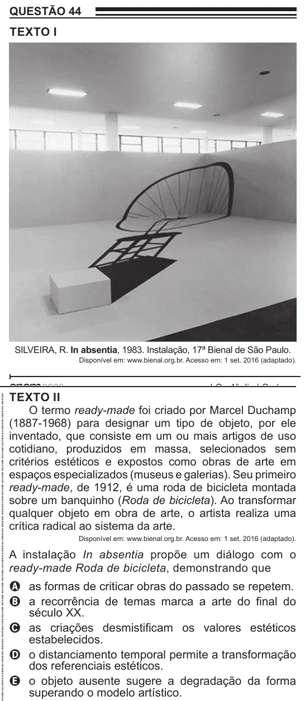

Texto extraído (pode conter ruído)

QUESTÃO 44  
TEXTO I  
SILVEIRA, R. In absentia, 1983. Instalação, 17ª Bienal de São Paulo.  
Disponível em: www.bienal.org.br. Acesso em: 1 set. 2016 (adaptado).  
TEXTO II  
O termo ready-made foi criado por Marcel Duchamp  
(1887-1968) para designar um tipo de objeto, por ele  
inventado, que consiste em um ou mais artigos de uso  
cotidiano, produzidos em massa, selecionados sem  
critérios estéticos e expostos como obras de arte em  
espaços especializados (museus e galerias). Seu primeiro  
ready-made, de 1912, é uma roda de bicicleta montada  
sobre um banquinho (Roda de bicicleta). Ao transformar  
qualquer objeto em obra de arte, o artista realiza uma  
crítica radical ao sistema da arte.  
Disponível em: www.bienal.org.br. Acesso em: 1 set. 2016 (adaptado).  
A instalação In absentia propõe um diálogo com o  
ready-made Roda de bicicleta, demonstrando que  
A as formas de criticar obras do passado se repetem.  
B a recorrência de temas marca a arte do final do  
século XX.  
C as criações desmistificam os valores estéticos  
estabelecidos.  
D o distanciamento temporal permite a transformação  
dos referenciais estéticos.  
E o objeto ausente sugere a degradação da forma  
superando o modelo artístico.

