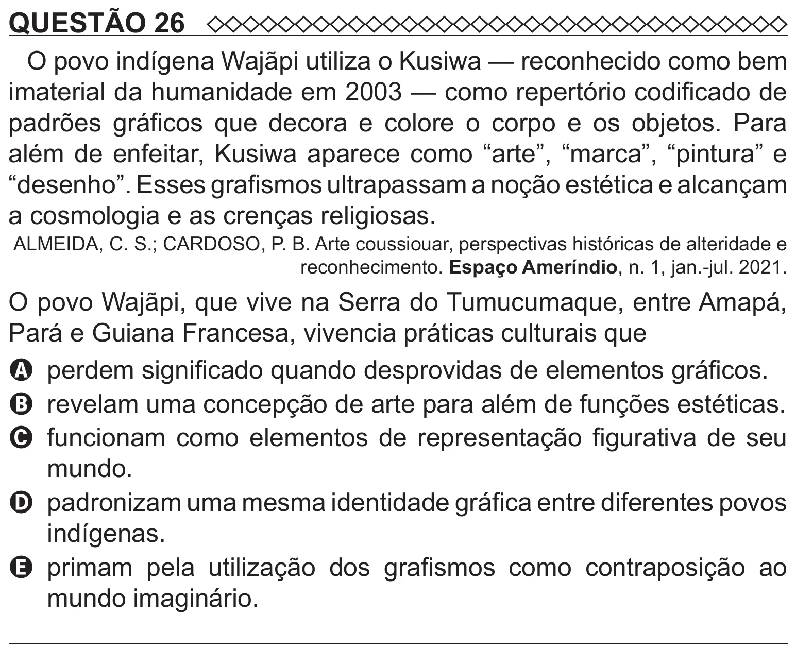

Texto extraído (pode conter ruído)

QUESTÃO 26  
O povo indígena Wajãpi utiliza o Kusiwa — reconhecido como bem  
imaterial da humanidade em 2003 — como repertório codificado de  
padrões gráficos que decora e colore o corpo e os objetos. Para  
além de enfeitar, Kusiwa aparece como “arte”, “marca”, “pintura” e  
“desenho”. Esses grafismos ultrapassam a noção estética e alcançam  
a cosmologia e as crenças religiosas.  
ALMEIDA, C. S.; CARDOSO, P. B. Arte coussiouar, perspectivas históricas de alteridade e  
reconhecimento. Espaço Ameríndio, n. 1, jan.-jul. 2021.  
O povo Wajãpi, que vive na Serra do Tumucumaque, entre Amapá,  
Pará e Guiana Francesa, vivencia práticas culturais que  
A perdem significado quando desprovidas de elementos gráficos.  
B revelam uma concepção de arte para além de funções estéticas.  
C funcionam como elementos de representação figurativa de seu  
mundo.  
D padronizam uma mesma identidade gráfica entre diferentes povos  
indígenas.  
E primam pela utilização dos grafismos como contraposição ao  
mundo imaginário.

