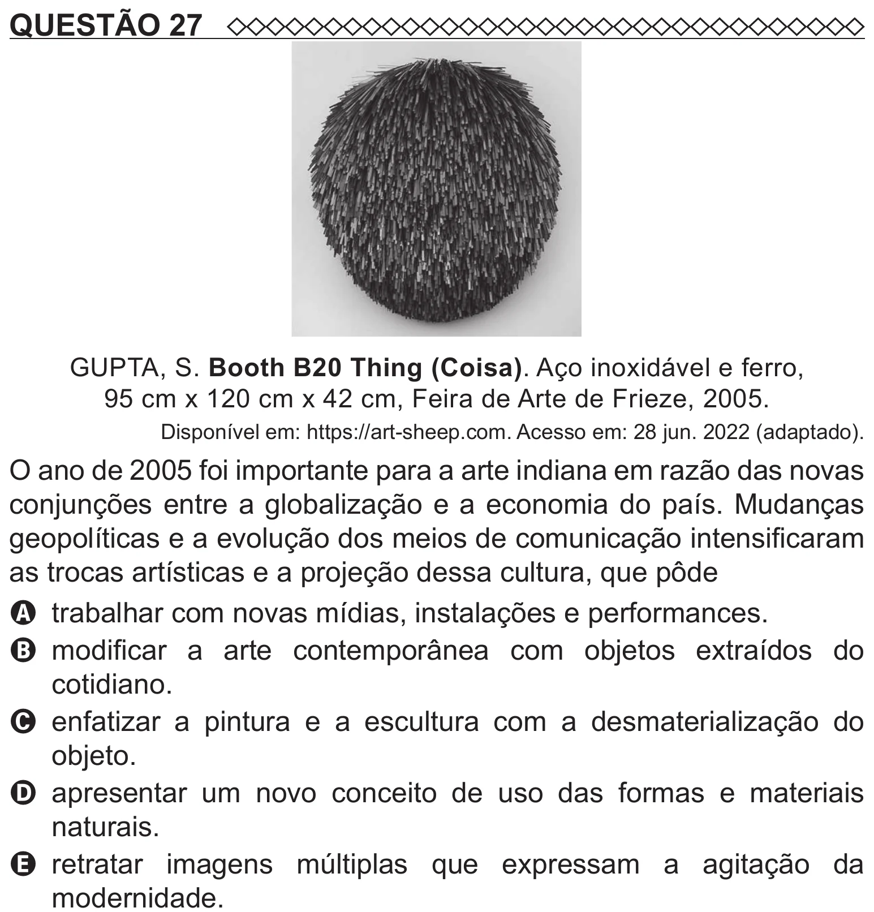

Texto extraído (pode conter ruído)

QUESTÃO 27  
GUPTA, S. Booth B20 Thing (Coisa). Aço inoxidável e ferro,  
95 cm x 120 cm x 42 cm, Feira de Arte de Frieze, 2005.  
Disponível em: https://art-sheep.com. Acesso em: 28 jun. 2022 (adaptado).  
O ano de 2005 foi importante para a arte indiana em razão das novas  
conjunções entre a globalização e a economia do país. Mudanças  
geopolíticas e a evolução dos meios de comunicação intensificaram  
as trocas artísticas e a projeção dessa cultura, que pôde  
A trabalhar com novas mídias, instalações e performances.  
B modificar a arte contemporânea com objetos extraídos do  
cotidiano.  
C enfatizar a pintura e a escultura com a desmaterialização do  
objeto.  
D   
apresentar um novo conceito de uso das formas e materiais  
naturais.  
E   
retratar imagens múltiplas que expressam a agitação da  
modernidade.

