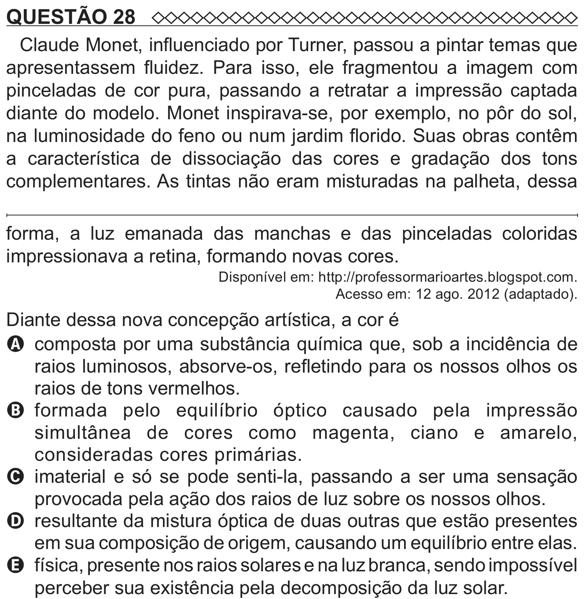

Texto extraído (pode conter ruído)

QUESTÃO 28  
Claude Monet, influenciado por Turner, passou a pintar temas que  
apresentassem fluidez. Para isso, ele fragmentou a imagem com  
pinceladas de cor pura, passando a retratar a impressão captada  
diante do modelo. Monet inspirava-se, por exemplo, no pôr do sol,  
na luminosidade do feno ou num jardim florido. Suas obras contêm  
a característica de dissociação das cores e gradação dos tons  
complementares. As tintas não eram misturadas na palheta, dessa  
forma, a luz emanada das manchas e das pinceladas coloridas  
impressionava a retina, formando novas cores.  
Disponível em: http://professormarioartes.blogspot.com.  
Acesso em: 12 ago. 2012 (adaptado).  
Diante dessa nova concepção artística, a cor é  
A composta por uma substância química que, sob a incidência de  
raios luminosos, absorve-os, refletindo para os nossos olhos os  
raios de tons vermelhos.  
B   
formada pelo equilíbrio óptico causado pela impressão  
simultânea de cores como magenta, ciano e amarelo,  
consideradas cores primárias.  
C imaterial e só se pode senti-la, passando a ser uma sensação  
provocada pela ação dos raios de luz sobre os nossos olhos.  
D resultante da mistura óptica de duas outras que estão presentes  
em sua composição de origem, causando um equilíbrio entre elas.  
E física, presente nos raios solares e na luz branca, sendo impossível

