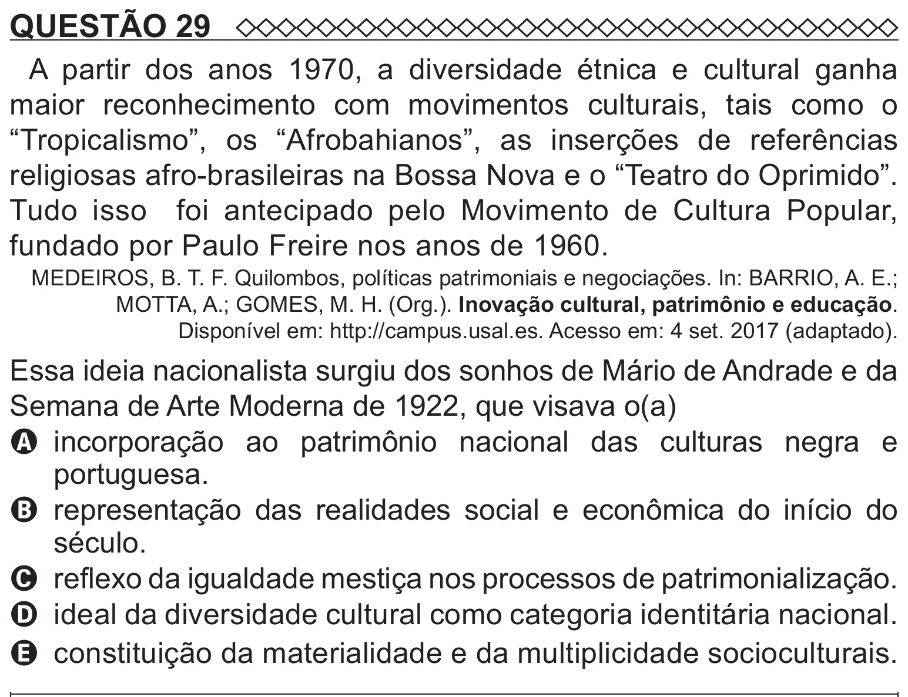

Texto extraído (pode conter ruído)

QUESTÃO 29  
A partir dos anos 1970, a diversidade étnica e cultural ganha  
maior reconhecimento com movimentos culturais, tais como o  
“Tropicalismo”, os “Afrobahianos”, as inserções de referências  
religiosas afro-brasileiras na Bossa Nova e o “Teatro do Oprimido”.  
Tudo isso foi antecipado pelo Movimento de Cultura Popular,  
fundado por Paulo Freire nos anos de 1960.  
MEDEIROS, B. T. F. Quilombos, políticas patrimoniais e negociações. In: BARRIO, A. E.;  
MOTTA, A.; GOMES, M. H. (Org.). Inovação cultural, patrimônio e educação.  
Disponível em: http://campus.usal.es. Acesso em: 4 set. 2017 (adaptado).  
Essa ideia nacionalista surgiu dos sonhos de Mário de Andrade e da  
Semana de Arte Moderna de 1922, que visava o(a)  
A   
incorporação ao patrimônio nacional das culturas negra e  
portuguesa.  
B representação das realidades social e econômica do início do  
século.  
C reflexo da igualdade mestiça nos processos de patrimonialização.  
D ideal da diversidade cultural como categoria identitária nacional.  
E constituição da materialidade e da multiplicidade socioculturais.

