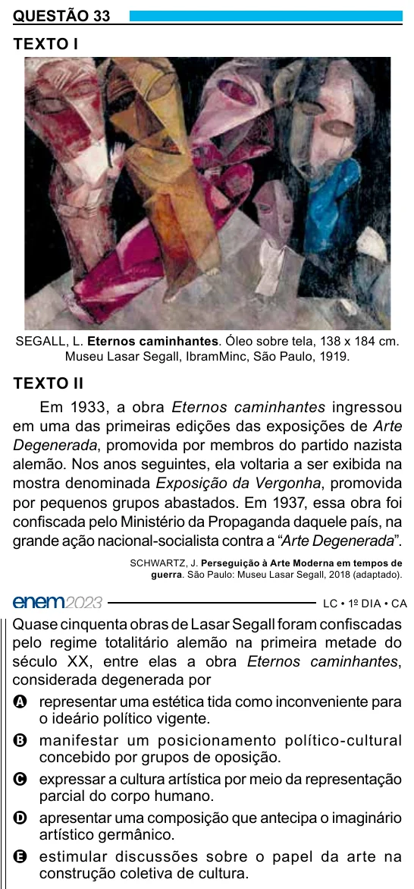

Texto extraído (pode conter ruído)

QUESTÃO 33  
TEXTO I  
SEGALL, L. Eternos caminhantes. Óleo sobre tela, 138 x 184 cm.  
Museu Lasar Segall, IbramMinc, São Paulo, 1919.  
TEXTO II  
Em 1933, a obra Eternos caminhantes ingressou  
em uma das primeiras edições das exposições de Arte  
Degenerada, promovida por membros do partido nazista  
alemão. Nos anos seguintes, ela voltaria a ser exibida na  
mostra denominada Exposição da Vergonha, promovida  
por pequenos grupos abastados. Em 1937, essa obra foi  
confiscada pelo Ministério da Propaganda daquele país, na  
grande ação nacional-socialista contra a “Arte Degenerada”.  
SCHWARTZ, J. Perseguição à Arte Moderna em tempos de  
guerra. São Paulo: Museu Lasar Segall, 2018 (adaptado).  
Quase cinquenta obras de Lasar Segall foram confiscadas  
pelo regime totalitário alemão na primeira metade do  
século XX, entre elas a obra Eternos caminhantes,  
considerada degenerada por  
A representar uma estética tida como inconveniente para  
o ideário político vigente.  
B manifestar um posicionamento político-cultural  
concebido por grupos de oposição.  
C expressar a cultura artística por meio da representação  
parcial do corpo humano.  
D apresentar uma composição que antecipa o imaginário  
artístico germânico.  
E estimular discussões sobre o papel da arte na  
construção coletiva de cultura.

