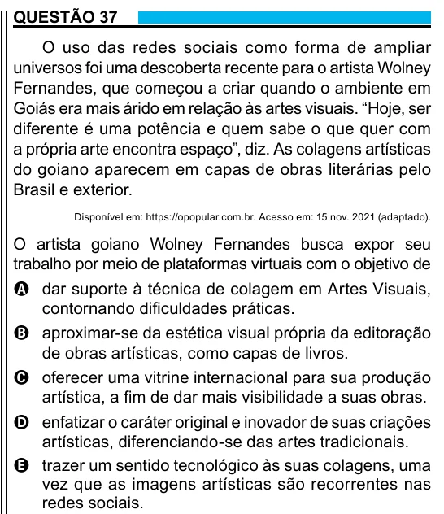

Texto extraído (pode conter ruído)

QUESTÃO 37  
O uso das redes sociais como forma de ampliar  
universos foi uma descoberta recente para o artista Wolney  
Fernandes, que começou a criar quando o ambiente em  
Goiás era mais árido em relação às artes visuais. “Hoje, ser  
diferente é uma potência e quem sabe o que quer com  
a própria arte encontra espaço”, diz. As colagens artísticas  
do goiano aparecem em capas de obras literárias pelo  
Brasil e exterior.  
Disponível em: https://opopular.com.br. Acesso em: 15 nov. 2021 (adaptado).  
O artista goiano Wolney Fernandes busca expor seu  
trabalho por meio de plataformas virtuais com o objetivo de  
A dar suporte à técnica de colagem em Artes Visuais,  
contornando dificuldades práticas.  
B aproximar-se da estética visual própria da editoração  
de obras artísticas, como capas de livros.  
C oferecer uma vitrine internacional para sua produção  
artística, a fim de dar mais visibilidade a suas obras.  
D enfatizar o caráter original e inovador de suas criações  
artísticas, diferenciando-se das artes tradicionais.  
E trazer um sentido tecnológico às suas colagens, uma  
vez que as imagens artísticas são recorrentes nas  
redes sociais.

