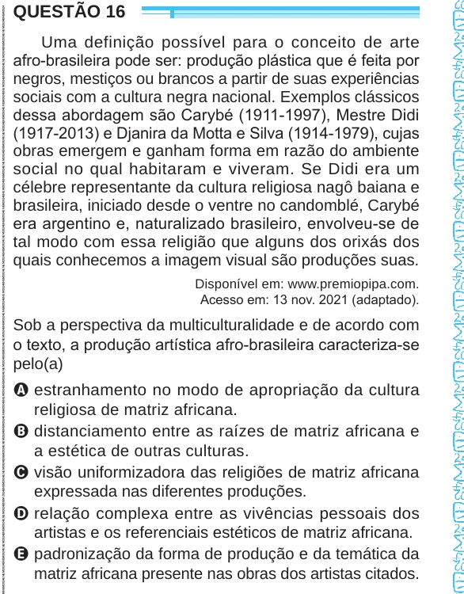

Texto extraído (pode conter ruído)

QUESTÃO 16  
Uma definição possível para o conceito de arte  
afro-brasileira pode ser: produção plástica que é feita por  
negros, mestiços ou brancos a partir de suas experiências  
sociais com a cultura negra nacional. Exemplos clássicos  
dessa abordagem são Carybé (1911-1997), Mestre Didi  
(1917-2013) e Djanira da Motta e Silva (1914-1979), cujas  
obras emergem e ganham forma em razão do ambiente  
social no qual habitaram e viveram. Se Didi era um  
célebre representante da cultura religiosa nagô baiana e  
brasileira, iniciado desde o ventre no candomblé, Carybé  
era argentino e, naturalizado brasileiro, envolveu-se de  
tal modo com essa religião que alguns dos orixás dos  
quais conhecemos a imagem visual são produções suas.  
Disponível em: www.premiopipa.com.  
Acesso em: 13 nov. 2021 (adaptado).  
Sob a perspectiva da multiculturalidade e de acordo com  
o texto, a produção artística afro-brasileira caracteriza-se  
pelo(a)  
A estranhamento no modo de apropriação da cultura  
religiosa de matriz africana.  
B distanciamento entre as raízes de matriz africana e  
a estética de outras culturas.  
C visão uniformizadora das religiões de matriz africana  
expressada nas diferentes produções.  
D relação complexa entre as vivências pessoais dos  
artistas e os referenciais estéticos de matriz africana.  
E padronização da forma de produção e da temática da  
matriz africana presente nas obras dos artistas citados.

