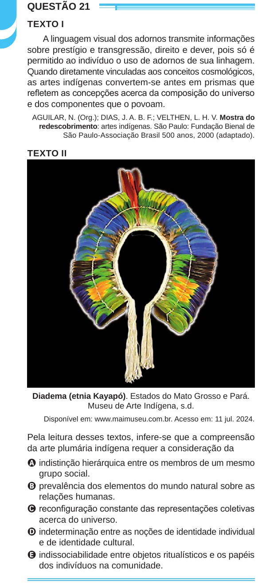

Texto extraído (pode conter ruído)

QUESTÃO 21  
TEXTO I  
A linguagem visual dos adornos transmite informações  
sobre prestígio e transgressão, direito e dever, pois só é  
permitido ao indivíduo o uso de adornos de sua linhagem.  
Quando diretamente vinculadas aos conceitos cosmológicos,  
as artes indígenas convertem-se antes em prismas que  
refletem as concepções acerca da composição do universo  
e dos componentes que o povoam.  
AGUILAR, N. (Org.); DIAS, J. A. B. F.; VELTHEN, L. H. V. Mostra do  
redescobrimento: artes indígenas. São Paulo: Fundação Bienal de  
São Paulo-Associação Brasil 500 anos, 2000 (adaptado).  
TEXTO II  
Diadema (etnia Kayapó). Estados do Mato Grosso e Pará.  
Museu de Arte Indígena, s.d.  
Disponível em: www.maimuseu.com.br. Acesso em: 11 jul. 2024.  
Pela leitura desses textos, infere-se que a compreensão  
da arte plumária indígena requer a consideração da  
A indistinção hierárquica entre os membros de um mesmo  
grupo social.  
B prevalência dos elementos do mundo natural sobre as  
relações humanas.  
C reconfiguração constante das representações coletivas  
acerca do universo.  
D indeterminação entre as noções de identidade individual  
e de identidade cultural.  
E indissociabilidade entre objetos ritualísticos e os papéis  
dos indivíduos na comunidade.

