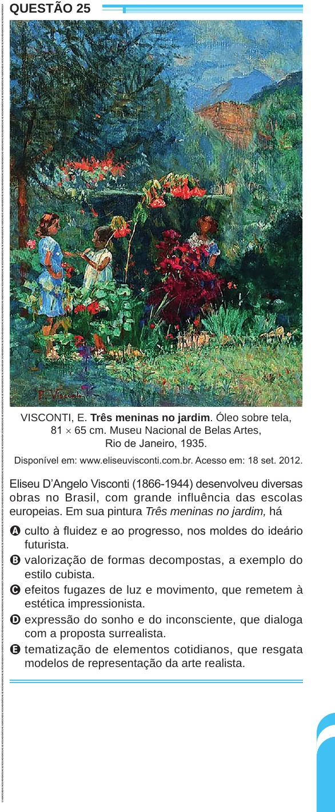

Texto extraído (pode conter ruído)

ENEM2024ENEM2024ENEM2024ENEM2024ENEM2024ENEM2024ENEM2024ENEM2024ENEM2024ENEM2024ENEM2024ENEM2024ENEM2024ENEM2024ENEM2024ENEM2024ENEM2024ENEM2024ENEM2024ENEM2024ENEM2024ENEM2024ENEM2024ENEM2024ENEM2024ENEM2024ENEM2024ENEM2024ENEM2024ENEM2024ENEM2024ENEM2024ENEM2024ENEM2024ENEM2024ENEM2024ENEM2024ENEM2024ENEM2024ENEM2024ENEM2024ENEM2024ENEM2024ENEM2024ENEM2024ENEM2024ENEM2024ENEM2024ENEM2024ENEM2024ENEM2024ENEM2024ENEM2024ENEM2024ENEM2024ENEM2024ENEM2024ENEM2024ENEM2024ENEM2024ENEM2024ENEM2024ENEM2024ENEM2024ENEM2024ENEM2024ENEM2024ENEM2024ENEM2024ENEM2024ENEM2024ENEM2024ENEM2024ENEM2024ENEM2024  
QUESTÃO 25  
VISCONTI, E. Três meninas no jardim. Óleo sobre tela,  
81 × 65 cm. Museu Nacional de Belas Artes,  
Rio de Janeiro, 1935.  
Disponível em: www.eliseuvisconti.com.br. Acesso em: 18 set. 2012.  
Eliseu D’Angelo Visconti (1866-1944) desenvolveu diversas  
obras no Brasil, com grande influência das escolas  
europeias. Em sua pintura Três meninas no jardim, há  
A culto à fluidez e ao progresso, nos moldes do ideário  
futurista.  
B valorização de formas decompostas, a exemplo do  
estilo cubista.  
C efeitos fugazes de luz e movimento, que remetem à  
estética impressionista.  
D expressão do sonho e do inconsciente, que dialoga  
com a proposta surrealista.  
E tematização de elementos cotidianos, que resgata  
modelos de representação da arte realista.

