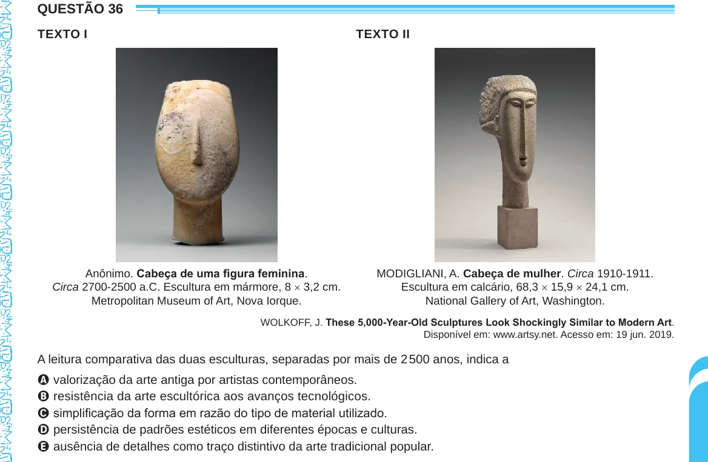

Texto extraído (pode conter ruído)

QUESTÃO 36  
TEXTO I  
TEXTO II  
Anônimo. Cabeça de uma figura feminina.  
MODIGLIANI, A. Cabeça de mulher. Circa 1910-1911.  
Circa 2700-2500 a.C. Escultura em mármore, 8 × 3,2 cm.  
Escultura em calcário, 68,3 × 15,9 × 24,1 cm.  
Metropolitan Museum of Art, Nova Iorque.  
National Gallery of Art, Washington.  
WOLKOFF, J. These 5,000-Year-Old Sculptures Look Shockingly Similar to Modern Art.  
Disponível em: www.artsy.net. Acesso em: 19 jun. 2019.  
A leitura comparativa das duas esculturas, separadas por mais de 2 500 anos, indica a  
A valorização da arte antiga por artistas contemporâneos.  
B resistência da arte escultórica aos avanços tecnológicos.  
C simplificação da forma em razão do tipo de material utilizado.  
D persistência de padrões estéticos em diferentes épocas e culturas.  
E ausência de detalhes como traço distintivo da arte tradicional popular.

