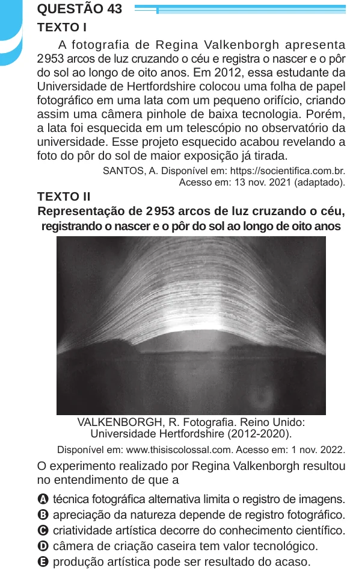

Texto extraído (pode conter ruído)

QUESTÃO 43  
TEXTO I  
A fotografia de Regina Valkenborgh apresenta  
2 953 arcos de luz cruzando o céu e registra o nascer e o pôr  
do sol ao longo de oito anos. Em 2012, essa estudante da  
Universidade de Hertfordshire colocou uma folha de papel  
fotográfico em uma lata com um pequeno orifício, criando  
assim uma câmera pinhole de baixa tecnologia. Porém,  
a lata foi esquecida em um telescópio no observatório da  
universidade. Esse projeto esquecido acabou revelando a  
foto do pôr do sol de maior exposição já tirada.  
SANTOS, A. Disponível em: https://socientifica.com.br.  
Acesso em: 13 nov. 2021 (adaptado).  
TEXTO II  
Representação de 2 953 arcos de luz cruzando o céu,  
registrando o nascer e o pôr do sol ao longo de oito anos  
VALKENBORGH, R. Fotografia. Reino Unido:  
Universidade Hertfordshire (2012-2020).  
Disponível em: www.thisiscolossal.com. Acesso em: 1 nov. 2022.  
O experimento realizado por Regina Valkenborgh resultou  
no entendimento de que a  
A técnica fotográfica alternativa limita o registro de imagens.  
B apreciação da natureza depende de registro fotográfico.  
C criatividade artística decorre do conhecimento científico.  
D câmera de criação caseira tem valor tecnológico.  
E produção artística pode ser resultado do acaso.

