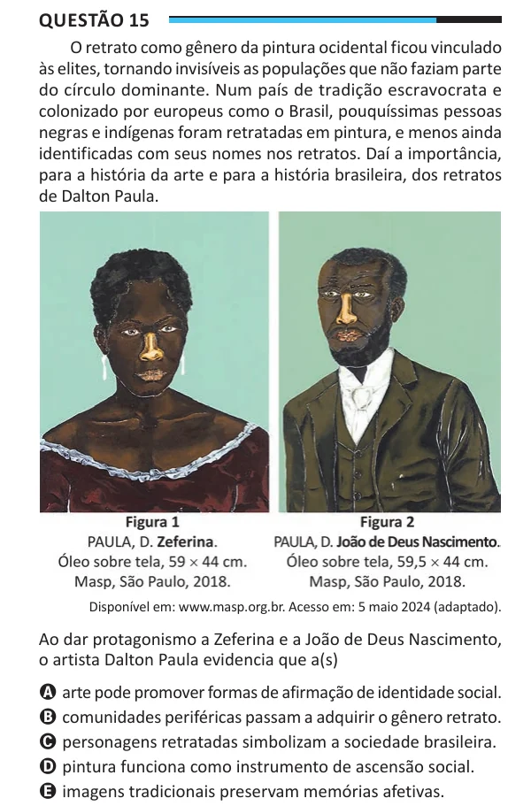

Texto extraído (pode conter ruído)

Questão 15  
O retrato como gênero da pintura ocidental ficou vinculado  
às elites, tornando invisíveis as populações que não faziam parte  
do círculo dominante. Num país de tradição escravocrata e  
colonizado por europeus como o Brasil, pouquíssimas pessoas  
negras e indígenas foram retratadas em pintura, e menos ainda  
identificadas com seus nomes nos retratos. Daí a importância,  
para a história da arte e para a história brasileira, dos retratos  
de Dalton Paula.  
Disponível em: www.masp.org.br. Acesso em: 5 maio 2024 (adaptado).  
Ao dar protagonismo a Zeferina e a João de Deus Nascimento,  
o artista Dalton Paula evidencia que a(s)  
A arte pode promover formas de afirmação de identidade social.  
B comunidades periféricas passam a adquirir o gênero retrato.  
C personagens retratadas simbolizam a sociedade brasileira.  
D pintura funciona como instrumento de ascensão social.  
E imagens tradicionais preservam memórias afetivas.

