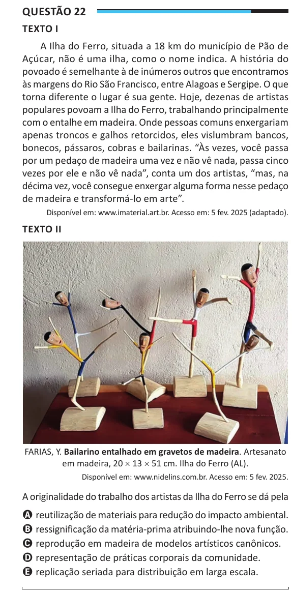

Texto extraído (pode conter ruído)

Questão 22  
TEXTO I  
A Ilha do Ferro, situada a 18 km do município de Pão de  
Açúcar, não é uma ilha, como o nome indica. A história do  
povoado é semelhante à de inúmeros outros que encontramos  
às margens do Rio São Francisco, entre Alagoas e Sergipe. O que  
torna diferente o lugar é sua gente. Hoje, dezenas de artistas  
populares povoam a Ilha do Ferro, trabalhando principalmente  
com o entalhe em madeira. Onde pessoas comuns enxergariam  
apenas troncos e galhos retorcidos, eles vislumbram bancos,  
bonecos, pássaros, cobras e bailarinas. “Às vezes, você passa  
por um pedaço de madeira uma vez e não vê nada, passa cinco  
vezes por ele e não vê nada”, conta um dos artistas, “mas, na  
décima vez, você consegue enxergar alguma forma nesse pedaço  
de madeira e transformá-lo em arte”.  
Disponível em: www.imaterial.art.br. Acesso em: 5 fev. 2025 (adaptado).  
TEXTO II  
FARIAS, Y. Bailarino entalhado em gravetos de madeira. Artesanato  
em madeira, 20 × 13 × 51 cm. Ilha do Ferro (AL).  
Disponível em: www.nidelins.com.br. Acesso em: 5 fev. 2025.  
A originalidade do trabalho dos artistas da Ilha do Ferro se dá pela  
A reutilização de materiais para redução do impacto ambiental.  
B ressignificação da matéria-prima atribuindo-lhe nova função.  
C reprodução em madeira de modelos artísticos canônicos.  
D representação de práticas corporais da comunidade.  
E replicação seriada para distribuição em larga escala.

