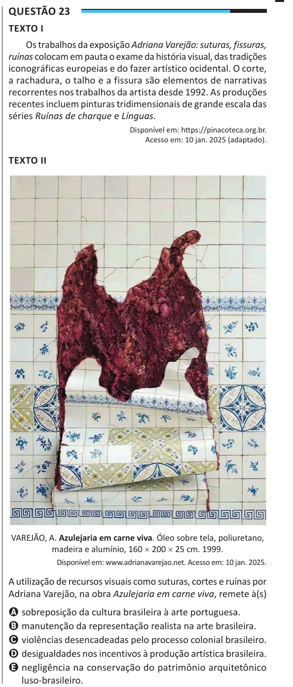

Texto extraído (pode conter ruído)

Questão 23  
TEXTO I  
Os trabalhos da exposição Adriana Varejão: suturas, fissuras,  
ruínas colocam em pauta o exame da história visual, das tradições  
iconográficas europeias e do fazer artístico ocidental. O corte,  
a rachadura, o talho e a fissura são elementos de narrativas  
recorrentes nos trabalhos da artista desde 1992. As produções  
recentes incluem pinturas tridimensionais de grande escala das  
séries Ruínas de charque e Línguas.  
Disponível em: https://pinacoteca.org.br.  
Acesso em: 10 jan. 2025 (adaptado).  
TEXTO II  
VAREJÃO, A. Azulejaria em carne viva. Óleo sobre tela, poliuretano,  
madeira e alumínio, 160 × 200 × 25 cm. 1999.  
Disponível em: www.adrianavarejao.net. Acesso em: 10 jan. 2025.  
A utilização de recursos visuais como suturas, cortes e ruínas por  
Adriana Varejão, na obra Azulejaria em carne viva, remete à(s)  
A sobreposição da cultura brasileira à arte portuguesa.  
B manutenção da representação realista na arte brasileira.  
C violências desencadeadas pelo processo colonial brasileiro.  
D desigualdades nos incentivos à produção artística brasileira.  
E negligência na conservação do patrimônio arquitetônico  
luso-brasileiro.

