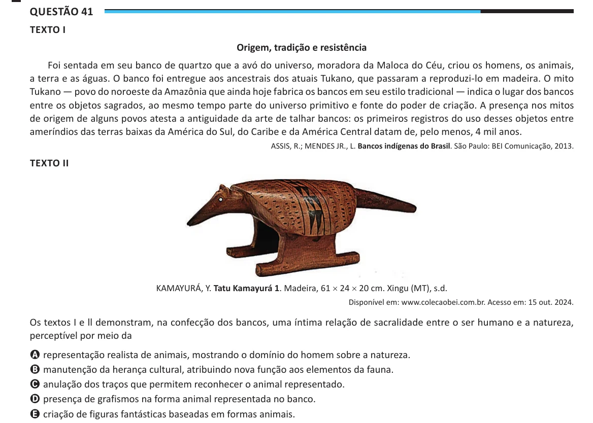

Texto extraído (pode conter ruído)

Questão 41  
TEXTO I  
Origem, tradição e resistência  
Foi sentada em seu banco de quartzo que a avó do universo, moradora da Maloca do Céu, criou os homens, os animais,  
a terra e as águas. O banco foi entregue aos ancestrais dos atuais Tukano, que passaram a reproduzi-lo em madeira. O mito  
Tukano — povo do noroeste da Amazônia que ainda hoje fabrica os bancos em seu estilo tradicional — indica o lugar dos bancos  
entre os objetos sagrados, ao mesmo tempo parte do universo primitivo e fonte do poder de criação. A presença nos mitos  
de origem de alguns povos atesta a antiguidade da arte de talhar bancos: os primeiros registros do uso desses objetos entre  
ameríndios das terras baixas da América do Sul, do Caribe e da América Central datam de, pelo menos, 4 mil anos.  
ASSIS, R.; MENDES JR., L. Bancos indígenas do Brasil. São Paulo: BEI Comunicação, 2013.  
TEXTO II  
KAMAYURÁ, Y. Tatu Kamayurá 1. Madeira, 61 × 24 × 20 cm. Xingu (MT), s.d.  
Disponível em: www.colecaobei.com.br. Acesso em: 15 out. 2024.  
Os textos I e ll demonstram, na confecção dos bancos, uma íntima relação de sacralidade entre o ser humano e a natureza,  
perceptível por meio da  
A representação realista de animais, mostrando o domínio do homem sobre a natureza.  
B manutenção da herança cultural, atribuindo nova função aos elementos da fauna.  
C anulação dos traços que permitem reconhecer o animal representado.  
D presença de grafismos na forma animal representada no banco.  
E criação de figuras fantásticas baseadas em formas animais.

