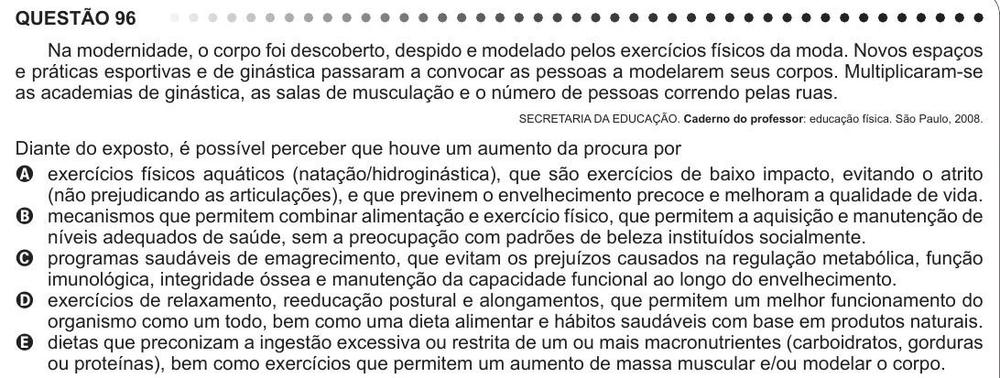

Texto extraído (pode conter ruído)

QUESTÃO 96  
Na modernidade, o corpo foi descoberto, despido e modelado pelos exercícios físicos da moda. Novos espaços  
e práticas esportivas e de ginástica passaram a convocar as pessoas a modelarem seus corpos. Multiplicaram-se  
as academias de ginástica, as salas de musculação e o número de pessoas correndo pelas ruas.  
SECRETARIA DA EDUCAÇÃO. Caderno do professor: educação física. São Paulo, 2008.  
Diante do exposto, é possível perceber que houve um aumento da procura por  
A exercícios físicos aquáticos (natação/hidroginástica), que são exercícios de baixo impacto, evitando o atrito  
(não prejudicando as articulações), e que previnem o envelhecimento precoce e melhoram a qualidade de vida.  
B mecanismos que permitem combinar alimentação e exercício físico, que permitem a aquisição e manutenção de  
níveis adequados de saúde, sem a preocupação com padrões de beleza instituídos socialmente.  
C programas saudáveis de emagrecimento, que evitam os prejuízos causados na regulação metabólica, função  
imunológica, integridade óssea e manutenção da capacidade funcional ao longo do envelhecimento.  
D exercícios de relaxamento, reeducação postural e alongamentos, que permitem um melhor funcionamento do  
organismo como um todo, bem como uma dieta alimentar e hábitos saudáveis com base em produtos naturais.  
E dietas que preconizam a ingestão excessiva ou restrita de um ou mais macronutrientes (carboidratos, gorduras  
ou proteínas), bem como exercícios que permitem um aumento de massa muscular e/ou modelar o corpo.

