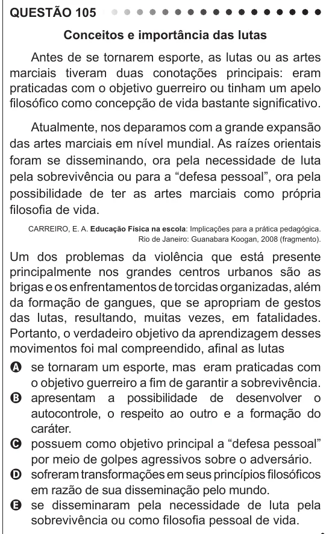

Texto extraído (pode conter ruído)

QUESTÃO 105  
Conceitos e importância das lutas  
Antes de se tornarem esporte, as lutas ou as artes  
marciais tiveram duas conotações principais: eram  
praticadas com o objetivo guerreiro ou tinham um apelo  
filosófico como concepção de vida bastante significativo.  
Atualmente, nos deparamos com a grande expansão  
das artes marciais em nível mundial. As raízes orientais  
foram se disseminando, ora pela necessidade de luta  
pela sobrevivência ou para a “defesa pessoal”, ora pela  
possibilidade de ter as artes marciais como própria  
filosofia de vida.  
CARREIRO, E. A. Educação Física na escola: Implicações para a prática pedagógica.  
Rio de Janeiro: Guanabara Koogan, 2008 (fragmento).  
Um dos problemas da violência que está presente  
principalmente nos grandes centros urbanos são as  
brigas e os enfrentamentos de torcidas organizadas, além  
da formação de gangues, que se apropriam de gestos  
das lutas, resultando, muitas vezes, em fatalidades.  
Portanto, o verdadeiro objetivo da aprendizagem desses  
movimentos foi mal compreendido, afinal as lutas  
A se tornaram um esporte, mas eram praticadas com  
o objetivo guerreiro a fim de garantir a sobrevivência.  
B apresentam a possibilidade de desenvolver o  
autocontrole, o respeito ao outro e a formação do  
caráter.  
C possuem como objetivo principal a “defesa pessoal”  
por meio de golpes agressivos sobre o adversário.  
D sofreram transformações em seus princípios filosóficos  
em razão de sua disseminação pelo mundo.  
E se disseminaram pela necessidade de luta pela  
sobrevivência ou como filosofia pessoal de vida.

