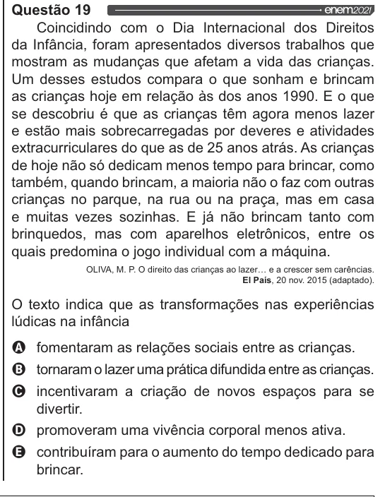

Texto extraído (pode conter ruído)

Questão 19  
Coincidindo com o Dia Internacional dos Direitos  
da Infância, foram apresentados diversos trabalhos que  
mostram as mudanças que afetam a vida das crianças.  
Um desses estudos compara o que sonham e brincam  
as crianças hoje em relação às dos anos 1990. E o que  
se descobriu é que as crianças têm agora menos lazer  
e estão mais sobrecarregadas por deveres e atividades  
extracurriculares do que as de 25 anos atrás. As crianças  
de hoje não só dedicam menos tempo para brincar, como  
também, quando brincam, a maioria não o faz com outras  
crianças no parque, na rua ou na praça, mas em casa  
e muitas vezes sozinhas. E já não brincam tanto com  
brinquedos, mas com aparelhos eletrônicos, entre os  
quais predomina o jogo individual com a máquina.  
OLIVA, M. P. O direito das crianças ao lazer... e a crescer sem carências.  
El País, 20 nov. 2015 (adaptado).  
O texto indica que as transformações nas experiências  
lúdicas na infância  
00 VOO  
fomentaram as relações sociais entre as crianças.  
tornaram o lazer uma prática difundida entre as crianças.  
incentivaram a criação de novos espaços para se  
divertir.  
promoveram uma vivência corporal menos ativa.  
contribuíram para o aumento do tempo dedicado para  
brincar.

