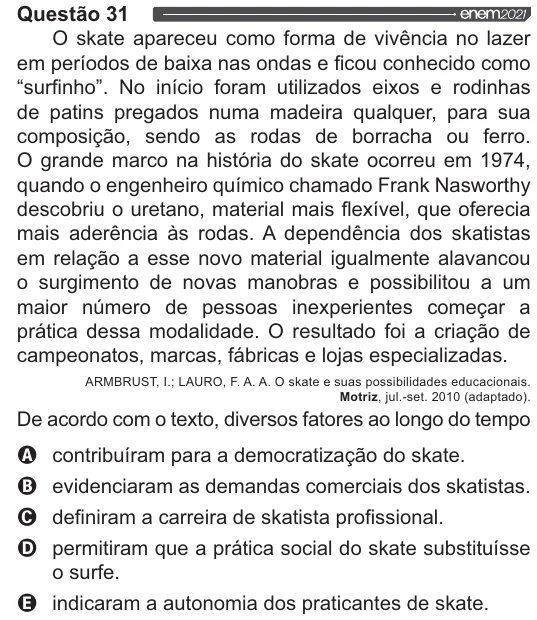

Texto extraído (pode conter ruído)

Questão 31  
O skate apareceu como forma de vivência no lazer  
em períodos de baixa nas ondas e ficou conhecido como  
“surfinho”. No início foram utilizados eixos e rodinhas  
de patins pregados numa madeira qualquer, para sua  
composição, sendo as rodas de borracha ou ferro.  
O grande marco na história do skate ocorreu em 1974,  
quando o engenheiro químico chamado Frank Nasworthy  
descobriu o uretano, material mais flexível, que oferecia  
mais aderência às rodas. A dependência dos skatistas  
em relação a esse novo material igualmente alavancou  
o surgimento de novas manobras e possibilitou a um  
maior número de pessoas inexperientes começar a  
prática dessa modalidade. O resultado foi a criação de  
campeonatos, marcas, fábricas e lojas especializadas.  
ARMBRUST, |.; LAURO, F. A. A. O skate e suas possibilidades educacionais.  
Motriz, jul.-set. 2010 (adaptado).  
De acordo com o texto, diversos fatores ao longo do tempo  
OVO v  
contribuíram para a democratização do skate.  
evidenciaram as demandas comerciais dos skatistas.  
definiram a carreira de skatista profissional.  
permitiram que a prática social do skate substituísse  
o surfe.  
indicaram a autonomia dos praticantes de skate.

