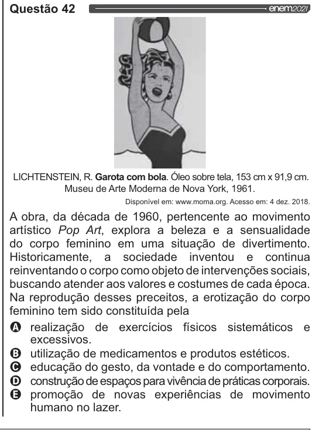

Texto extraído (pode conter ruído)

Questão 42  
LICHTENSTEIN, R. Garota com bola. Óleo sobre tela, 153 cm x 91,9 cm.  
Museu de Arte Moderna de Nova York, 1961.  
Disponível em: www.moma.org. Acesso em: 4 dez. 2018.  
A obra, da década de 1960, pertencente ao movimento  
artístico Pop Art, explora a beleza e a sensualidade  
do corpo feminino em uma situação de divertimento.  
Historicamente, a sociedade inventou e continua  
reinventando o corpo como objeto de intervenções sociais,  
buscando atender aos valores e costumes de cada época.  
Na reprodução desses preceitos, a erotização do corpo  
feminino tem sido constituída pela  
Q realização de exercícios físicos sistemáticos e  
excessivos.

