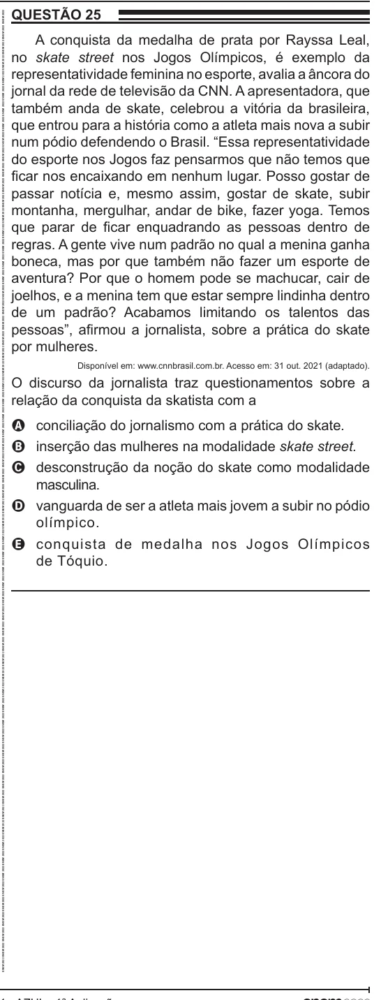

Texto extraído (pode conter ruído)

QUESTÃO 25  
ENEM 2022 ENEM 2022 ENEM 2022 ENEM 2022 ENEM 2022 ENEM 2022 ENEM 2022 ENEM 2022 ENEM 2022 ENEM 2022 ENEM 2022 ENEM 2022 ENEM 2022 ENEM 2022 ENEM 2022 ENEM 2022 ENEM 2022 ENEM 2022 ENEM 2022 ENEM 2022 ENEM 2022 ENEM 2022 ENEM 2022 ENEM 2022 ENEM 2022 ENEM 2022 ENEM 2022 ENEM 2022 ENEM 2022 ENEM 2022 ENEM 2022 ENEM 2022 ENEM 2022 ENEM 2022 ENEM 2022 ENEM 2022 ENEM 2022 ENEM 2022 ENEM 2022 ENEM 2022 ENEM 2022 ENEM 2022 ENEM 2022 ENEM 2022 ENEM 2022 ENEM 2022 ENEM 2022 ENEM 2022 ENEM 2022 ENEM 2022 ENEM 2022 ENEM 2022 ENEM 2022 ENEM 2022 ENEM 2022 ENEM 2022 ENEM 2022 ENEM 2022 ENEM 2022 ENEM 2022 ENEM 2022 ENEM 2022 ENEM 2022  
A conquista da medalha de prata por Rayssa Leal,  
no skate street nos Jogos Olímpicos, é exemplo da  
representatividade feminina no esporte, avalia a âncora do  
jornal da rede de televisão da CNN. A apresentadora, que  
também anda de skate, celebrou a vitória da brasileira,  
que entrou para a história como a atleta mais nova a subir  
num pódio defendendo o Brasil. “Essa representatividade  
do esporte nos Jogos faz pensarmos que não temos que  
ficar nos encaixando em nenhum lugar. Posso gostar de  
passar notícia e, mesmo assim, gostar de skate, subir  
montanha, mergulhar, andar de bike, fazer yoga. Temos  
que parar de ficar enquadrando as pessoas dentro de  
regras. A gente vive num padrão no qual a menina ganha  
boneca, mas por que também não fazer um esporte de  
aventura? Por que o homem pode se machucar, cair de  
joelhos, e a menina tem que estar sempre lindinha dentro  
de um padrão? Acabamos limitando os talentos das  
pessoas”, afirmou a jornalista, sobre a prática do skate  
por mulheres.  
Disponível em: www.cnnbrasil.com.br. Acesso em: 31 out. 2021 (adaptado).  
O discurso da jornalista traz questionamentos sobre a  
relação da conquista da skatista com a  
A conciliação do jornalismo com a prática do skate.  
B inserção das mulheres na modalidade skate street.  
C desconstrução da noção do skate como modalidade  
masculina.  
D vanguarda de ser a atleta mais jovem a subir no pódio  
olímpico.  
E conquista de medalha nos Jogos Olímpicos  
de Tóquio.

