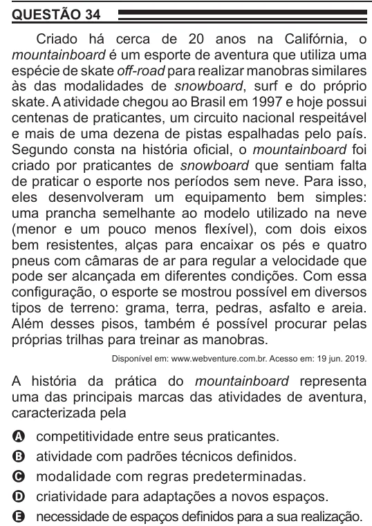

Texto extraído (pode conter ruído)

QUESTÃO 34  
Criado há cerca de 20 anos na Califórnia, o  
mountainboard é um esporte de aventura que utiliza uma  
espécie de skate off-road para realizar manobras similares  
às das modalidades de snowboard, surf e do próprio  
skate. A atividade chegou ao Brasil em 1997 e hoje possui  
centenas de praticantes, um circuito nacional respeitável  
e mais de uma dezena de pistas espalhadas pelo país.  
Segundo consta na história oficial, o mountainboard foi  
criado por praticantes de snowboard que sentiam falta  
de praticar o esporte nos períodos sem neve. Para isso,  
eles desenvolveram um equipamento bem simples:  
uma prancha semelhante ao modelo utilizado na neve  
(menor e um pouco menos flexível), com dois eixos  
bem resistentes, alças para encaixar os pés e quatro  
pneus com câmaras de ar para regular a velocidade que  
pode ser alcançada em diferentes condições. Com essa  
configuração, o esporte se mostrou possível em diversos  
tipos de terreno: grama, terra, pedras, asfalto e areia.  
Além desses pisos, também é possível procurar pelas  
próprias trilhas para treinar as manobras.  
Disponível em: www.webventure.com.br. Acesso em: 19 jun. 2019.  
A história da prática do mountainboard representa  
uma das principais marcas das atividades de aventura,  
caracterizada pela  
competitividade entre seus praticantes.  
A  
atividade com padrões técnicos definidos.  
B  
C  
modalidade com regras predeterminadas.  
criatividade para adaptações a novos espaços.  
D  
necessidade de espaços definidos para a sua realização.  
E

