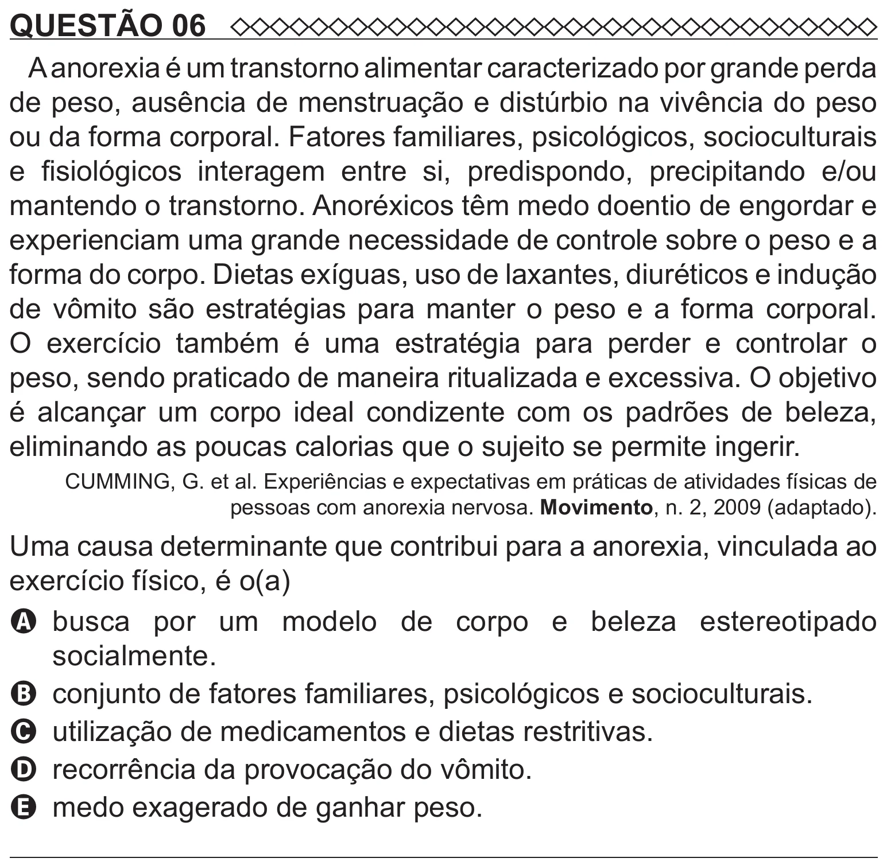

Texto extraído (pode conter ruído)

QUESTÃO 06  
A anorexia é um transtorno alimentar caracterizado por grande perda  
de peso, ausência de menstruação e distúrbio na vivência do peso  
ou da forma corporal. Fatores familiares, psicológicos, socioculturais  
e fisiológicos interagem entre si, predispondo, precipitando e/ou  
mantendo o transtorno. Anoréxicos têm medo doentio de engordar e  
experienciam uma grande necessidade de controle sobre o peso e a  
forma do corpo. Dietas exíguas, uso de laxantes, diuréticos e indução  
de vômito são estratégias para manter o peso e a forma corporal.  
O exercício também é uma estratégia para perder e controlar o  
peso, sendo praticado de maneira ritualizada e excessiva. O objetivo  
é alcançar um corpo ideal condizente com os padrões de beleza,  
eliminando as poucas calorias que o sujeito se permite ingerir.  
CUMMING, G. et al. Experiências e expectativas em práticas de atividades físicas de  
pessoas com anorexia nervosa. Movimento, n. 2, 2009 (adaptado).  
Uma causa determinante que contribui para a anorexia, vinculada ao  
exercício físico, é o(a)  
A   
busca por um modelo de corpo e beleza estereotipado  
socialmente.  
B conjunto de fatores familiares, psicológicos e socioculturais.  
C utilização de medicamentos e dietas restritivas.  
D recorrência da provocação do vômito.  
E medo exagerado de ganhar peso.

