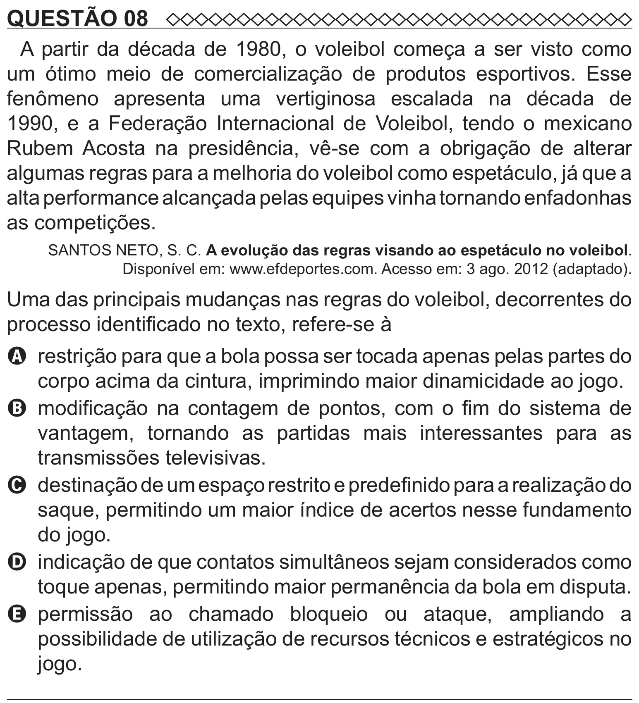

Texto extraído (pode conter ruído)

QUESTÃO 08  
A partir da década de 1980, o voleibol começa a ser visto como  
um ótimo meio de comercialização de produtos esportivos. Esse  
fenômeno apresenta uma vertiginosa escalada na década de  
1990, e a Federação Internacional de Voleibol, tendo o mexicano  
Rubem Acosta na presidência, vê-se com a obrigação de alterar  
algumas regras para a melhoria do voleibol como espetáculo, já que a  
alta performance alcançada pelas equipes vinha tornando enfadonhas  
as competições.  
SANTOS NETO, S. C. A evolução das regras visando ao espetáculo no voleibol.  
Disponível em: www.efdeportes.com. Acesso em: 3 ago. 2012 (adaptado).  
Uma das principais mudanças nas regras do voleibol, decorrentes do  
processo identificado no texto, refere-se à  
A restrição para que a bola possa ser tocada apenas pelas partes do  
corpo acima da cintura, imprimindo maior dinamicidade ao jogo.  
B modificação na contagem de pontos, com o fim do sistema de  
vantagem, tornando as partidas mais interessantes para as  
transmissões televisivas.  
C destinação de um espaço restrito e predefinido para a realização do  
saque, permitindo um maior índice de acertos nesse fundamento  
do jogo.  
D indicação de que contatos simultâneos sejam considerados como  
toque apenas, permitindo maior permanência da bola em disputa.  
E   
permissão ao chamado bloqueio ou ataque, ampliando a  
possibilidade de utilização de recursos técnicos e estratégicos no  
jogo.

