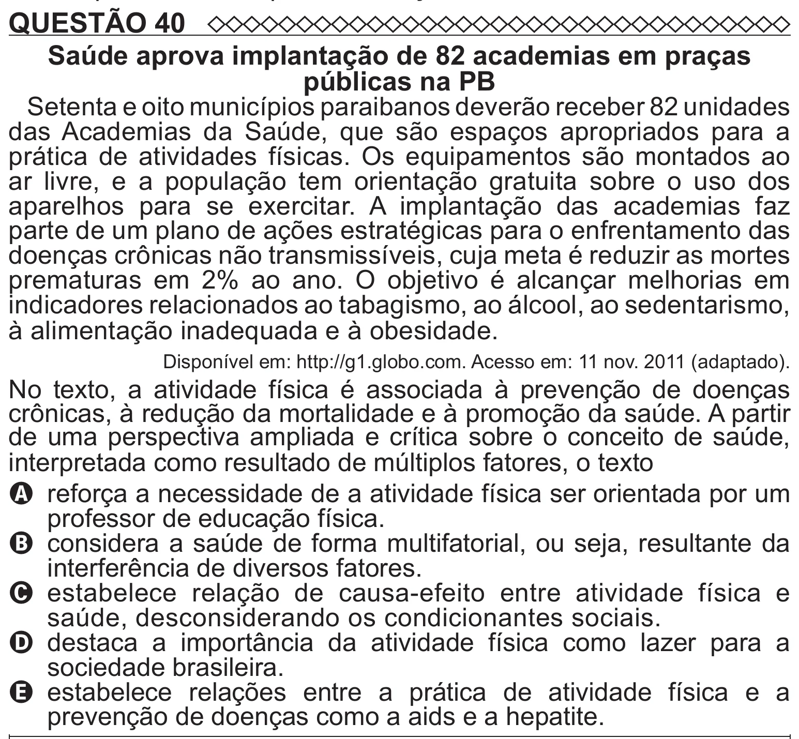

Texto extraído (pode conter ruído)

QUESTÃO 40  
Saúde aprova implantação de 82 academias em praças  
públicas na PB  
Setenta e oito municípios paraibanos deverão receber 82 unidades  
das Academias da Saúde, que são espaços apropriados para a  
prática de atividades físicas. Os equipamentos são montados ao  
ar livre, e a população tem orientação gratuita sobre o uso dos  
aparelhos para se exercitar. A implantação das academias faz  
parte de um plano de ações estratégicas para o enfrentamento das  
doenças crônicas não transmissíveis, cuja meta é reduzir as mortes  
prematuras em 2% ao ano. O objetivo é alcançar melhorias em  
indicadores relacionados ao tabagismo, ao álcool, ao sedentarismo,  
à alimentação inadequada e à obesidade.  
Disponível em: http://g1.globo.com. Acesso em: 11 nov. 2011 (adaptado).  
No texto, a atividade física é associada à prevenção de doenças  
crônicas, à redução da mortalidade e à promoção da saúde. A partir  
de uma perspectiva ampliada e crítica sobre o conceito de saúde,  
interpretada como resultado de múltiplos fatores, o texto  
A reforça a necessidade de a atividade física ser orientada por um  
professor de educação física.  
B considera a saúde de forma multifatorial, ou seja, resultante da  
interferência de diversos fatores.  
C   
estabelece relação de causa-efeito entre atividade física e  
saúde, desconsiderando os condicionantes sociais.  
D   
destaca a importância da atividade física como lazer para a  
sociedade brasileira.  
E   
estabelece relações entre a prática de atividade física e a  
prevenção de doenças como a aids e a hepatite.

