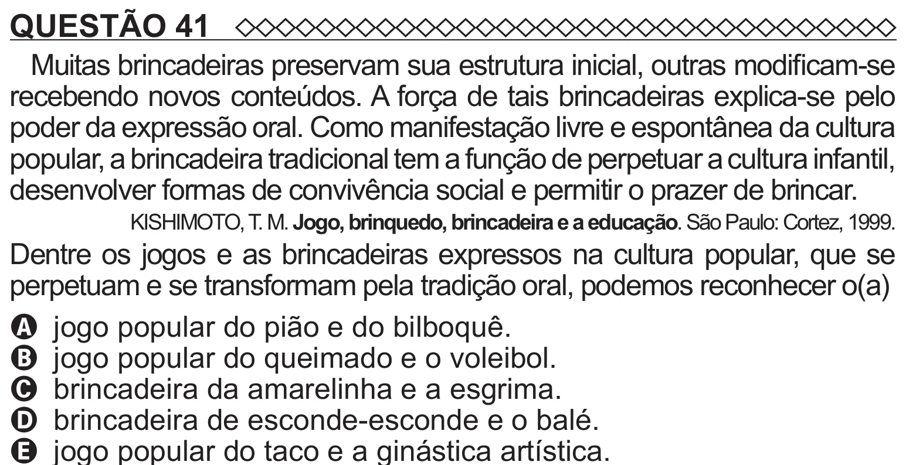

Texto extraído (pode conter ruído)

QUESTÃO 41  
Muitas brincadeiras preservam sua estrutura inicial, outras modificam-se  
recebendo novos conteúdos. A força de tais brincadeiras explica-se pelo  
poder da expressão oral. Como manifestação livre e espontânea da cultura  
popular, a brincadeira tradicional tem a função de perpetuar a cultura infantil,  
desenvolver formas de convivência social e permitir o prazer de brincar.  
KISHIMOTO, T. M. Jogo, brinquedo, brincadeira e a educação. São Paulo: Cortez, 1999.  
Dentre os jogos e as brincadeiras expressos na cultura popular, que se  
perpetuam e se transformam pela tradição oral, podemos reconhecer o(a)  
A jogo popular do pião e do bilboquê.  
B jogo popular do queimado e o voleibol.  
C brincadeira da amarelinha e a esgrima.  
D brincadeira de esconde-esconde e o balé.

