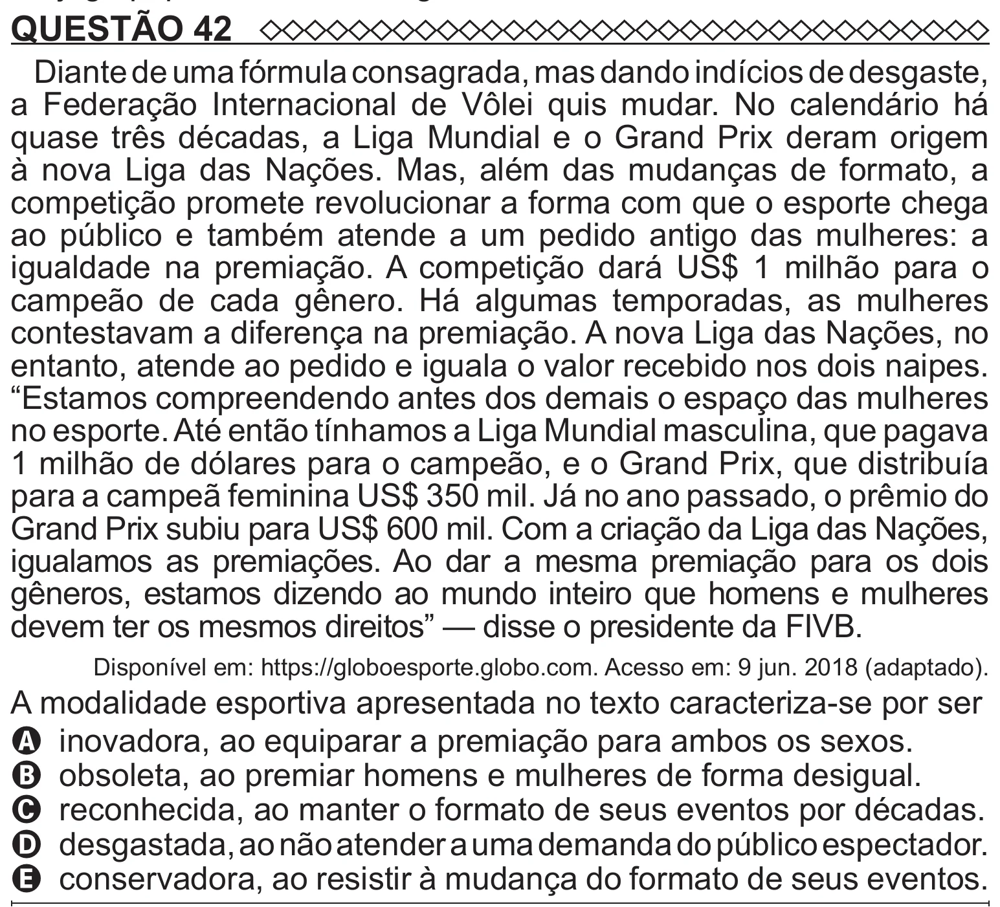

Texto extraído (pode conter ruído)

QUESTÃO 42  
Diante de uma fórmula consagrada, mas dando indícios de desgaste,  
a Federação Internacional de Vôlei quis mudar. No calendário há  
quase três décadas, a Liga Mundial e o Grand Prix deram origem  
à nova Liga das Nações. Mas, além das mudanças de formato, a  
competição promete revolucionar a forma com que o esporte chega  
ao público e também atende a um pedido antigo das mulheres: a  
igualdade na premiação. A competição dará US$ 1 milhão para o  
campeão de cada gênero. Há algumas temporadas, as mulheres  
contestavam a diferença na premiação. A nova Liga das Nações, no  
entanto, atende ao pedido e iguala o valor recebido nos dois naipes.  
“Estamos compreendendo antes dos demais o espaço das mulheres  
no esporte. Até então tínhamos a Liga Mundial masculina, que pagava  
1 milhão de dólares para o campeão, e o Grand Prix, que distribuía  
para a campeã feminina US$ 350 mil. Já no ano passado, o prêmio do  
Grand Prix subiu para US$ 600 mil. Com a criação da Liga das Nações,  
igualamos as premiações. Ao dar a mesma premiação para os dois  
gêneros, estamos dizendo ao mundo inteiro que homens e mulheres  
devem ter os mesmos direitos” — disse o presidente da FIVB.  
Disponível em: https://globoesporte.globo.com. Acesso em: 9 jun. 2018 (adaptado).  
A modalidade esportiva apresentada no texto caracteriza-se por ser  
A inovadora, ao equiparar a premiação para ambos os sexos.  
B obsoleta, ao premiar homens e mulheres de forma desigual.  
C reconhecida, ao manter o formato de seus eventos por décadas.  
D desgastada, ao não atender a uma demanda do público espectador.  
E conservadora, ao resistir à mudança do formato de seus eventos.

