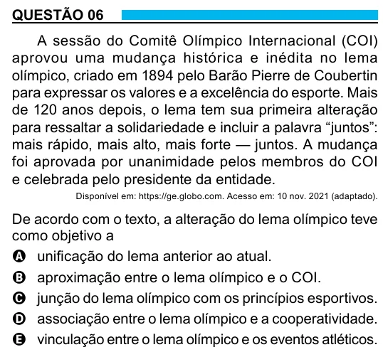

Texto extraído (pode conter ruído)

QUESTÃO 06  
A sessão do Comitê Olímpico Internacional (COI)  
aprovou uma mudança histórica e inédita no lema  
olímpico, criado em 1894 pelo Barão Pierre de Coubertin  
para expressar os valores e a excelência do esporte. Mais  
de 120 anos depois, o lema tem sua primeira alteração  
para ressaltar a solidariedade e incluir a palavra “juntos”:  
mais rápido, mais alto, mais forte — juntos. A mudança  
foi aprovada por unanimidade pelos membros do COI  
e celebrada pelo presidente da entidade.  
Disponível em: https://ge.globo.com. Acesso em: 10 nov. 2021 (adaptado).  
De acordo com o texto, a alteração do lema olímpico teve  
como objetivo a  
A unificação do lema anterior ao atual.  
B aproximação entre o lema olímpico e o COI.  
C junção do lema olímpico com os princípios esportivos.  
D associação entre o lema olímpico e a cooperatividade.  
E vinculação entre o lema olímpico e os eventos atléticos.

