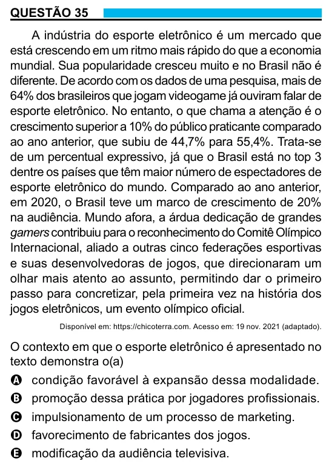

Texto extraído (pode conter ruído)

QUESTÃO 35  
A indústria do esporte eletrônico é um mercado que  
está crescendo em um ritmo mais rápido do que a economia  
mundial. Sua popularidade cresceu muito e no Brasil não é  
diferente. De acordo com os dados de uma pesquisa, mais de  
64% dos brasileiros que jogam videogame já ouviram falar de  
esporte eletrônico. No entanto, o que chama a atenção é o  
crescimento superior a 10% do público praticante comparado  
ao ano anterior, que subiu de 44,7% para 55,4%. Trata-se  
de um percentual expressivo, já que o Brasil está no top 3  
dentre os países que têm maior número de espectadores de  
esporte eletrônico do mundo. Comparado ao ano anterior,  
em 2020, o Brasil teve um marco de crescimento de 20%  
na audiência. Mundo afora, a árdua dedicação de grandes  
gamers contribuiu para o reconhecimento do Comitê Olímpico  
Internacional, aliado a outras cinco federações esportivas  
e suas desenvolvedoras de jogos, que direcionaram um  
olhar mais atento ao assunto, permitindo dar o primeiro  
passo para concretizar, pela primeira vez na história dos  
jogos eletrônicos, um evento olímpico oficial.  
Disponível em: https://chicoterra.com. Acesso em: 19 nov. 2021 (adaptado).  
O contexto em que o esporte eletrônico é apresentado no  
texto demonstra o(a)  
A condição favorável à expansão dessa modalidade.  
B promoção dessa prática por jogadores profissionais.  
C impulsionamento de um processo de marketing.  
D favorecimento de fabricantes dos jogos.  
E modificação da audiência televisiva.

