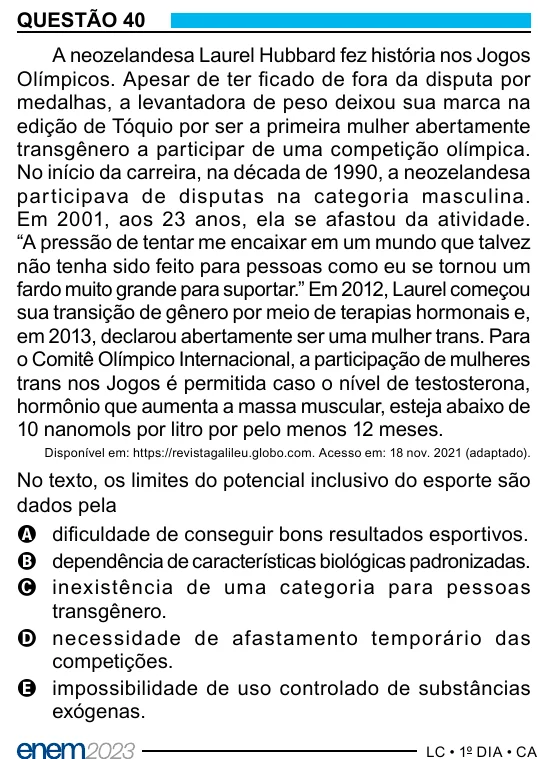

Texto extraído (pode conter ruído)

QUESTÃO 40  
A neozelandesa Laurel Hubbard fez história nos Jogos  
Olímpicos. Apesar de ter ficado de fora da disputa por  
medalhas, a levantadora de peso deixou sua marca na  
edição de Tóquio por ser a primeira mulher abertamente  
transgênero a participar de uma competição olímpica.  
No início da carreira, na década de 1990, a neozelandesa  
par ticipava de disputas na categoria masculina.  
Em 2001, aos 23 anos, ela se afastou da atividade.  
“A pressão de tentar me encaixar em um mundo que talvez  
não tenha sido feito para pessoas como eu se tornou um  
fardo muito grande para suportar.” Em 2012, Laurel começou  
sua transição de gênero por meio de terapias hormonais e,  
em 2013, declarou abertamente ser uma mulher trans. Para  
o Comitê Olímpico Internacional, a participação de mulheres  
trans nos Jogos é permitida caso o nível de testosterona,  
hormônio que aumenta a massa muscular, esteja abaixo de  
10 nanomols por litro por pelo menos 12 meses.  
Disponível em: https://revistagalileu.globo.com. Acesso em: 18 nov. 2021 (adaptado).  
No texto, os limites do potencial inclusivo do esporte são  
dados pela  
A dificuldade de conseguir bons resultados esportivos.  
B dependência de características biológicas padronizadas.  
C inexistência de uma categoria para pessoas  
transgênero.  
D necessidade de afastamento temporário das  
competições.  
E impossibilidade de uso controlado de substâncias  
exógenas.

